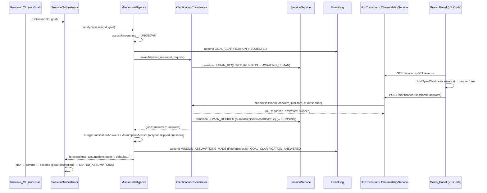

# Design Document: Goal Clarification Gate (Phase 1)

## Overview

Tài liệu này mô tả cách thêm một cổng làm rõ goal (opt-in, `--clarify on` cùng `--mission on`) vào runtime CodeForge v2. Cổng dùng lại hạ tầng sẵn có:

- `assessUncertainty` (Tier A) tiếp tục là bộ phát hiện duy nhất. Cổng chỉ kích hoạt khi level là `UNKNOWN` và có ít nhất một câu hỏi mở.
- Trạng thái session `AWAITING_HUMAN`, với các sự kiện `HUMAN_REQUIRED` / `HUMAN_DECIDED` và guard `humanDecisionRecorded` (SS-007), được dùng lại nguyên vẹn. Không thêm trạng thái mới.
- Mẫu "chờ người trong lúc run" của `NodeApprovalCoordinator` (P10.5) được nhân bản thành `ClarificationCoordinator`.
- `EventLog` (SQLite) là kho lưu duy nhất. Không thêm bảng hay migration.
- Đường `MissionStageDecision.assumptions` → `goalAssumptions` → section `STATED_ASSUMPTIONS` đã có sẵn trong `SessionOrchestrator` và `TaskExecutor`. Vì vậy **không cần sửa orchestrator hay executor**.
- `AssumptionAdvisor` được dùng lại để sinh giả định mặc định cho những câu hỏi người dùng bỏ qua.

Phạm vi ngoài thiết kế: Phase 2 (nhiều phương án kế hoạch), cập nhật web dashboard (`dashboard-assets.ts`), và tiếp tục một run bị gián đoạn sau khi runtime khởi động lại (xem mục Hạn chế).

## Architecture

### Luồng tổng thể



### Quyết định thiết kế chính

**1. Dùng lại `AWAITING_HUMAN` thay vì thêm `CLARIFICATION_REQUIRED`.**

- Session machine (`session-machine.ts`) là bảng chuyển trạng thái thuần, gắn với các bất biến SS-002/SS-007/SM-003. Thêm một trạng thái mới kéo theo sửa `SessionState`, `ControlPlane` (cancel đang cho phép từ `AWAITING_HUMAN`), `statusFromSessionState` của extension, test invariants và tài liệu spec. Chi phí đó vượt ngân sách 200–300 LOC mà không thêm năng lực nào.
- Ngữ nghĩa trùng khớp: "runtime dừng, chờ quyết định của con người, rồi tiếp tục qua `HUMAN_DECIDED` khi đã ghi nhận quyết định". Đó chính là mô tả của SS-007.
- *Lý do* dừng được phân biệt bằng event `GOAL_CLARIFICATION_REQUESTED` (giống cách `TOOL_CALL_REQUESTED`/approval phân biệt trường hợp chờ phê duyệt tool). Client đọc event chứ không đọc tên trạng thái.
- Cancel/abort từ `AWAITING_HUMAN` đã có sẵn trong bảng chuyển trạng thái và trong `ControlPlane`, nên người dùng vẫn hủy được trong lúc chờ.

**2. Chờ *bên trong* `orchestrator.run()` (giống `NodeApprovalCoordinator`), không trả `AWAITING_HUMAN` rồi chạy lại.**

Đường ArchitectureGate BLOCK hiện tại trả `AWAITING_HUMAN` cho caller. Tuy nhiên `runGoal` trong CLI sau đó **ABORT** mọi session `AWAITING_HUMAN` để nhả workspace lock (P10.7). Ngoài ra `run()` luôn bắt đầu bằng `SESSION_INITIALIZED` từ `CREATED`, nên không thể gọi lại cho một session đã chạy. Chờ trong run giữ được lock và toàn bộ ngữ cảnh (mission, revision, languageHint) mà không phải sửa CLI hay orchestrator. Đường BLOCK chỉ được dùng lại cho trường hợp người dùng *hủy* trong lúc chờ (`proceed:false`).

**3. Cổng nằm trong `MissionIntelligence`, dưới dạng một port tùy chọn `ClarificationGate`.**

- Phát hiện (`assessUncertainty`), sinh giả định (`AssumptionAdvisor`) và phát event `MISSION_*` đều đã ở đây, nên gộp câu trả lời cũng ở đây.
- agent-core chỉ định nghĩa interface và các hàm thuần. Việc chuyển trạng thái session do implementation ở infrastructure làm qua `SessionService`, giống `ApprovalCoordinator` (DC-002, không thêm đường authority thứ hai).
- Khi port vắng mặt (cờ tắt), luồng Tier B1 hiện tại chạy y hệt (MI-002 parity).

**4. Một đường ghi duy nhất cho event.**

Endpoint **không** ghi event. Nó chỉ chuyển câu trả lời đã kiểm tra cho coordinator. `MissionIntelligence.emit` là nơi duy nhất append `GOAL_CLARIFICATION_*`, giữ đúng tinh thần OB-009 (observability server là bề mặt đọc và điều khiển, không phải đường ghi thứ hai).

**5. Chống gửi trùng bằng thao tác check-and-remove đồng bộ.**

`ClarificationCoordinator.submit()` là hàm **đồng bộ**. Nó lấy entry chờ, kiểm tra hợp lệ, xóa entry và resolve promise trong cùng một tick. Event loop đơn luồng của Node bảo đảm hai POST đồng thời không thể cùng được chấp nhận. POST thứ hai nhận 409.

**6. Ranh giới tin cậy của câu trả lời.**

`STATED_ASSUMPTIONS` là section `trusted`, còn câu trả lời là nội dung do người dùng gõ, cùng mức tin cậy với chính Goal. Theo yêu cầu, câu trả lời được đưa vào `goalAssumptions`, với các biện pháp giảm thiểu sau:

- chuẩn hóa về **một dòng** (loại ký tự điều khiển, gộp xuống dòng). Nhờ đó câu trả lời không thể giả mạo một header section `[LABEL]` mới hay thêm bullet giả;
- giới hạn 500 ký tự;
- tiền tố `[user-provided]` để model phân biệt giá trị do người dùng cung cấp với giả định do runtime suy ra.

Rủi ro còn lại: một câu trả lời có thể chứa văn bản mang tính chỉ thị. Rủi ro này tương đương với việc người dùng viết thẳng vào goal, và enforcement thật vẫn nằm ở ToolGateway/policy (SE-002).

### Ngân sách LOC (mã production, ước tính)

| Thành phần | File | LOC |
|---|---|---|
| Hàm thuần + types | `agent-core/src/mission/goal-clarification.ts` (mới) | ~85 |
| Tích hợp stage | `agent-core/src/mission/mission-intelligence.ts` | ~45 |
| Event types + export | `agent-core/src/domain/event.ts`, `mission/index.ts` | ~5 |
| Coordinator | `infrastructure/src/approval-runtime/clarification-coordinator.ts` (mới) | ~65 |
| Service + transport | `observability-service.ts`, `http-transport.ts` | ~40 |
| CLI | `runtime-cli.ts` | ~12 |
| Extension | `goal-history.ts`, `goals-webview.ts`, `extension.ts`, `runtime-client.ts`, `runtime-launch.ts`, `package.json` | ~90 |
| **Tổng** | | **~340** |

Tổng ước tính hơi vượt mục tiêu 300 do phần webview HTML/JS. Nếu cần cắt, hãy bỏ nhóm radio `suggestedOptions` (chỉ giữ ô nhập văn bản). Cách này tiết kiệm khoảng 25 LOC.

## Components and Interfaces

### C1. `goal-clarification.ts` (agent-core, mới, thuần)

Không I/O, không clock, không LLM (MI-005). Mọi hàm đều tất định.

```typescript
export interface OpenQuestion {
  readonly id: string;                         // 'q1'..'qN'
  readonly text: string;
  readonly suggestedOptions?: readonly string[];
}

export interface ClarificationRequest {
  readonly requestId: string;
  readonly missionId: string;
  readonly goalId: string;
  readonly openQuestions: readonly OpenQuestion[];
}

/** questionId → normalized answer ('' = skipped). */
export type ClarificationAnswers = Readonly<Record<string, string>>;

export type ClarificationOutcome =
  | { readonly kind: 'answered'; readonly answers: ClarificationAnswers }
  | { readonly kind: 'timeout' }
  | { readonly kind: 'cancelled' };

/** Port implemented in infrastructure. MUST NOT throw (fail-safe). */
export interface ClarificationGate {
  awaitAnswers(sessionId: string, request: ClarificationRequest): Promise<ClarificationOutcome>;
}

export const MAX_ANSWER_LENGTH = 500;

export type AnswerValidationCode =
  | 'EMPTY_ANSWERS' | 'NON_STRING_ANSWER' | 'UNKNOWN_QUESTION' | 'ANSWER_TOO_LONG';

export type AnswerValidation =
  | { readonly ok: true; readonly answers: ClarificationAnswers }   // normalized
  | { readonly ok: false; readonly code: AnswerValidationCode; readonly message: string };

export interface AnsweredQuestion { readonly questionId: string; readonly question: string; readonly answer: string }

export interface MergedClarification {
  readonly answered: readonly AnsweredQuestion[];        // id order
  readonly skipped: readonly OpenQuestion[];             // id order
  readonly userStatements: readonly string[];            // '[user-provided] <q> → <a>'
}

export function buildClarificationRequest(
  requestId: string, missionId: string, goalId: string, openQuestions: readonly string[],
): ClarificationRequest;
export function normalizeAnswer(raw: string): string;
export function validateClarificationAnswers(request: ClarificationRequest, raw: unknown): AnswerValidation;
export function mergeClarificationAnswers(request: ClarificationRequest, answers: ClarificationAnswers): MergedClarification;
```

Hành vi:

- `buildClarificationRequest`: gán `q${i+1}` theo thứ tự đầu vào (thứ tự đã sort của `assessUncertainty`). `suggestedOptions` lấy từ một bảng tĩnh `SUGGESTED_OPTIONS: ReadonlyMap<string, readonly string[]>`, keyed theo đúng văn bản câu hỏi của analyzer. Ví dụ, câu hỏi "What does done look like…" có các gợi ý `Unit tests` / `An example input → expected output` / `Manual check is enough`. Câu hỏi "What are the inputs and outputs…" có các gợi ý `Command-line arguments → stdout` / `A function/library API` / `Read a file → write a file`. Câu hỏi không có trong bảng thì không có trường này.
- `normalizeAnswer`: thay mọi ký tự điều khiển (`\p{Cc}`) bằng dấu cách, gộp `\s+` thành một dấu cách, rồi trim.
- `validateClarificationAnswers`: kiểm tra theo thứ tự sau, dừng ở lỗi đầu tiên.
  1. `raw` không phải object thuần hoặc không có key → `EMPTY_ANSWERS`.
  2. Một giá trị không phải chuỗi → `NON_STRING_ANSWER`.
  3. Một key không phải id câu hỏi → `UNKNOWN_QUESTION` (message `unknown question id: <id>`).
  4. Một câu trả lời đã chuẩn hóa dài hơn `MAX_ANSWER_LENGTH` → `ANSWER_TOO_LONG`.

  Nếu hợp lệ, hàm trả về map đã chuẩn hóa.
- `mergeClarificationAnswers`: duyệt câu hỏi theo thứ tự id. Câu trả lời đã chuẩn hóa khác rỗng → `answered` + `userStatements`. Ngược lại → `skipped`.

### C2. `MissionIntelligence` (agent-core, sửa)

```typescript
export interface MissionIntelligenceDeps {
  // ...existing fields
  /** Opt-in (--clarify on). Absent ⇒ existing Tier B1 assume-and-state path, unchanged. */
  readonly clarificationGate?: ClarificationGate;
}
```

Khối Tier B1 hiện tại được tách thành một private method `resolveAmbiguity(sessionId, missionId, goal, mission)`. Method này trả `{ mission, clarification?, statements, cancelled }`:

1. **Nhánh cổng**: khi có `clarificationGate`, `mission.uncertainty.level === 'UNKNOWN'` và `openQuestions.length > 0`:
   1. `request = buildClarificationRequest(newId(), missionId, goal.goalId, openQuestions)`;
   2. emit `GOAL_CLARIFICATION_REQUESTED`;
   3. `outcome = await gate.awaitAnswers(sessionId, request)`;
   4. nếu `cancelled` thì trả `cancelled: true` (không emit `ANSWERED`);
   5. `answers = outcome.kind === 'answered' ? outcome.answers : {}`, và `source` tương ứng là `'user' | 'timeout'`;
   6. `merged = mergeClarificationAnswers(request, answers)`;
   7. nếu `merged.skipped.length > 0` và có `assumptionAdvisor`, gọi `clarify({ ...mission, uncertainty: { level: mission.uncertainty.level, openQuestions: skipped.map(q => q.text) } })` trong try/catch. Khi thành công, emit `MISSION_ASSUMPTIONS_MADE` như hiện tại và mirror acceptance vào bản sao Mission như hiện tại;
   8. nếu `merged.skipped.length === 0` thì `mission = { ...mission, uncertainty: { level: 'KNOWN', openQuestions: [] } }`;
   9. `statements = [...merged.userStatements, ...defaults]`;
   10. emit `GOAL_CLARIFICATION_ANSWERED`.
2. **Nhánh cũ**: mọi trường hợp khác chạy đúng logic Tier B1 hiện có, không đổi một dòng hành vi nào.

Khi `cancelled`, `analyze` trả sớm với `proceed: false`, `blockers: ['clarification cancelled']`. Các trường thuần bắt buộc (`contextStrategy`, `contextPlan`, `promptPlan`, `expertProfile`) vẫn được tính, nhưng bỏ qua routing và architect (không tốn thêm lời gọi LLM).

### C3. `ClarificationCoordinator` (infrastructure, mới)

File `packages/infrastructure/src/approval-runtime/clarification-coordinator.ts` nằm cạnh `approval-coordinator.ts` và dùng cùng các port tối giản.

```typescript
export interface SessionStateReader {
  getById(sessionId: string): Promise<{ readonly state: string } | null>;
}

export interface ClarificationCoordinatorOptions {
  readonly sessionService: SessionTransitionPort;   // reuse from approval-coordinator.ts
  readonly sessions: SessionStateReader;
  readonly pollIntervalMs?: number;                 // default 300
  readonly maxWaitMs?: number;                      // default 3_600_000
  readonly nowMs?: () => number;
  readonly sleep?: (ms: number) => Promise<void>;
}

export type SubmitClarificationResult =
  | { readonly ok: true; readonly requestId: string; readonly answered: number; readonly skipped: number }
  | { readonly ok: false; readonly code: 'NOT_AWAITING' | AnswerValidationCode; readonly message: string };

export class ClarificationCoordinator implements ClarificationGate {
  constructor(opts: ClarificationCoordinatorOptions);
  awaitAnswers(sessionId: string, request: ClarificationRequest): Promise<ClarificationOutcome>;
  /** Synchronous check-and-remove: at most one accepted submission per request. */
  submit(sessionId: string, rawAnswers: unknown): SubmitClarificationResult;
}
```

Trạng thái nội bộ: `pending: Map<sessionId, { request, resolve: (a: ClarificationAnswers) => void }>`.

`awaitAnswers`:

1. Đăng ký entry trong `pending` cùng một promise `answered`.
2. Gọi `transition(sessionId, 'HUMAN_REQUIRED')` trong try/catch. Nếu lỗi và session không ở `AWAITING_HUMAN`, xóa entry và trả `cancelled`.
3. Vòng lặp: `Promise.race([answered, sleep(pollIntervalMs)])`.
   - Khi có câu trả lời → `answered`.
   - Đọc `sessions.getById`. Nếu state khác `AWAITING_HUMAN` → `cancelled`.
   - Nếu `nowMs() >= deadline` → `timeout`.
4. Ở `finally`, xóa entry khỏi `pending`. Với `answered` hoặc `timeout`, gọi `transition(sessionId, 'HUMAN_DECIDED', { humanDecisionRecorded: true })` (best-effort). Hàm không bao giờ ném lỗi.

`submit`:

1. `entry = pending.get(sessionId)`. Nếu không có entry → `NOT_AWAITING`.
2. `v = validateClarificationAnswers(entry.request, raw)`. Nếu lỗi → trả lỗi và giữ entry.
3. `pending.delete(sessionId)`, rồi `entry.resolve(v.answers)`.
4. Trả `{ ok: true, requestId, answered, skipped }`, với các số đếm từ `mergeClarificationAnswers`.

### C4. `ObservabilityService` + `HttpTransport` (infrastructure, sửa)

```typescript
/** Accepts clarification answers (POST /clarification). Optional; absent ⇒ 501. */
export interface ClarificationIngressPort {
  submit(sessionId: string, rawAnswers: unknown): SubmitClarificationResult;
}
// ObservabilityServiceDeps: readonly clarification?: ClarificationIngressPort;
// ObservabilityServiceError code union += 'CLARIFICATION_UNSUPPORTED'
// ObservabilityService.submitClarification(sessionId: string, rawAnswers: unknown): Promise<SubmitClarificationResult>
//   - no port → throw CLARIFICATION_UNSUPPORTED
//   - sessions.getById(sessionId) === null → throw SESSION_NOT_FOUND
//   - else delegate to port.submit
```

Hợp đồng `POST /clarification` (route thêm vào `handle`, ghi chú vào bảng Routes ở đầu file):

| Thứ tự kiểm tra | Điều kiện | HTTP | Body |
|---|---|---|---|
| 1 | Body không parse được JSON | 400 | `{ error: 'invalid JSON body' }` |
| 2 | `sessionId` không phải chuỗi khác rỗng | 400 | `{ error: 'sessionId required' }` |
| 3 | `answers` không phải object thuần, hoặc không có key | 400 | `{ error: 'answers required' }` |
| 4 | Clarification chưa được wire | 501 | `{ error: 'clarification not enabled' }` |
| 5 | Session không tồn tại | 404 | `{ error: 'session not found' }` |
| 6 | Không có request đang chờ (đã trả lời, trả lời trùng, runtime đã restart) | 409 | `{ error: 'session not awaiting clarification' }` |
| 7 | `NON_STRING_ANSWER` | 400 | `{ error: 'answers must be strings' }` |
| 8 | `UNKNOWN_QUESTION` | 400 | `{ error: 'unknown question id: <id>' }` |
| 9 | `ANSWER_TOO_LONG` | 400 | `{ error: 'answer too long' }` |
| — | Thành công | 200 | `{ requestId, answered, skipped }` |

Body mẫu: `{ "sessionId": "…", "answers": { "q1": "Unit tests", "q2": "" } }`. Ở đây `q2` bị bỏ qua, tức là người dùng chấp nhận giả định mặc định.

### C5. `runtime-cli.ts` (infrastructure, sửa)

- Đọc cờ: `clarifyArg = (args['clarify'] ?? 'off').toLowerCase() === 'on'`, rồi `clarifyOn = clarifyArg && missionOn`. Nếu `clarifyArg && !missionOn`, in `⚠ --clarify on requires --mission on — clarification disabled`.
- Khi `clarifyOn`, tạo `clarificationCoordinator = new ClarificationCoordinator({ sessionService: …, sessions })`, rồi truyền `clarificationGate` vào `MissionIntelligence` và `clarification` vào `ObservabilityService`.
- Banner: `Clarify:    ON (ask the user when a goal is UNKNOWN)` hoặc `off (assume-and-state)`.
- Cập nhật comment usage ở đầu file với `--clarify <on|off>`.

### C6. Extension VS Code (sửa)

- **`runtime-client.ts`**: thêm `postClarification(sessionId, answers): Promise<{ status: number; body: { requestId?: string; answered?: number; skipped?: number; error?: string } }>`. Hàm không ném lỗi. Lỗi mạng trả về `{ status: 0, body: { error: 'runtime unreachable' } }`.
- **`goal-history.ts`** (thuần, có test): thêm hàm sau.
  ```typescript
  export interface OpenClarificationView {
    readonly requestId: string;
    readonly questions: readonly { readonly id: string; readonly text: string; readonly suggestedOptions?: readonly string[] }[];
  }
  /** Latest GOAL_CLARIFICATION_REQUESTED whose requestId has no GOAL_CLARIFICATION_ANSWERED; else null. Defensive payload parsing. */
  export function findOpenClarification(events: readonly { readonly type: string; readonly payload?: unknown }[]): OpenClarificationView | null;
  ```
- **`goals-webview.ts`**:
  - `GoalEntryView` thêm `clarification?: OpenClarificationView`.
  - Khi trường này có mặt, render một `<form>` dưới reply với chip `needs input`. Mỗi câu hỏi có `<label for="cf-<requestId>-<qid>">` và `<input type="text" id=…>`. Nếu có `suggestedOptions`, render `<fieldset><legend>…</legend>` chứa các `<input type="radio" name=…>` + `<label>`; chọn radio sẽ điền giá trị vào ô text.
  - Hai `<button type="submit">` là "Send answers" và "Use defaults for all", cùng một `<div role="status" aria-live="polite">`.
  - Mọi văn bản đi qua `esc()`.
  - Trong lúc gửi, nút bị `disabled`. Nút được bật lại khi nhận message `clarifyResult` có `ok:false`.
  - Focus vào ô nhập đầu tiên đúng một lần cho mỗi `requestId`, lưu trong một `Set` của script.
  - Giá trị đang nhập được giữ qua các lần re-render (lưu theo `requestId`/`qid` trong script trước khi `render` thay `innerHTML`).
  - Protocol mới:
    - webview → extension: `{ type: 'clarify', sessionId, requestId, answers }`;
    - extension → webview: `{ type: 'clarifyResult', requestId, ok, message }`.
- **`extension.ts`**:
  - Trong `refreshAll`, sau `reconcileHistory`, với mỗi entry có `sessionId` mà session (từ `listSessions()`) đang ở `AWAITING_HUMAN`: gọi `client.getEvents(sessionId)` rồi `findOpenClarification`. Kết quả lưu vào `Map<sessionId, OpenClarificationView>`. Map này chỉ dùng cho view, không ghi vào `globalState`, nên trạng thái luôn suy từ runtime.
  - `toEntryView` gắn `clarification`.
  - Handler `clarify` gọi `postClarification`, rồi post `clarifyResult` với message lấy từ `body.error` hoặc `Answers sent (answered N, skipped M)`, sau đó `refreshAll()`.
- **`runtime-launch.ts` + `package.json`**: setting boolean `codeforge.clarify` (mặc định `false`). Khi bằng `true`, `buildRuntimeArgs` thêm `--mission on --clarify on`.

## Data Models

### Event `GOAL_CLARIFICATION_REQUESTED`

`aggregate: { kind: 'mission', id: missionId }`.

```json
{
  "requestId": "01J…",
  "missionId": "01J…",
  "goalId": "g-1",
  "level": "UNKNOWN",
  "openQuestions": [
    { "id": "q1", "text": "The goal uses open-ended wording — what specifically should it do?" },
    { "id": "q2", "text": "What are the inputs and outputs (types, format, an example of input → expected output)?",
      "suggestedOptions": ["Command-line arguments → stdout", "A function/library API", "Read a file → write a file"] }
  ]
}
```

### Event `GOAL_CLARIFICATION_ANSWERED`

```json
{
  "requestId": "01J…",
  "source": "user",
  "answers": [{ "questionId": "q2", "question": "What are the inputs…?", "answer": "A function/library API" }],
  "skippedQuestionIds": ["q1"],
  "assumptions": [
    "[user-provided] What are the inputs…? → A function/library API",
    "<default assumption from AssumptionAdvisor for q1>"
  ]
}
```

`source: 'timeout'` nghĩa là `answers: []` và mọi id nằm trong `skippedQuestionIds`.

### Ánh xạ trạng thái

| Sự kiện runtime | Session state | Thấy trong UI |
|---|---|---|
| Request được tạo | `RUNNING` → `AWAITING_HUMAN` (`HUMAN_REQUIRED`) | form + chip `needs input` |
| Câu trả lời được chấp nhận / timeout | `AWAITING_HUMAN` → `RUNNING` (`HUMAN_DECIDED`) | form biến mất khi có `ANSWERED` |
| Người dùng cancel | `AWAITING_HUMAN` → `CANCELLING` → `ABORTED` (CLI ABORT sau run) | `failed` |

## Error Handling

- **Stage advisory không được làm hỏng run**: `ClarificationGate.awaitAnswers` không ném lỗi. Nếu nó vẫn ném (vi phạm hợp đồng), try/catch có sẵn quanh `missionStage.analyze` trong orchestrator sẽ rơi về planning bình thường (hành vi hiện có).
- **`AssumptionAdvisor` lỗi** với câu bỏ qua: tiếp tục chỉ với User_Statement (Req 7.5).
- **Append event lỗi**: `emit` hiện tại nuốt lỗi (best-effort). Cổng vẫn chạy. Hậu quả là UI không thấy request, và hành vi khi đó là timeout sau `maxWaitMs`, rồi rơi về giả định mặc định. Người dùng vẫn cancel được qua `/control`.
- **Chuyển trạng thái lỗi**: `HUMAN_REQUIRED` lỗi → `cancelled` (session không còn `RUNNING`). `HUMAN_DECIDED` lỗi → bỏ qua (session đã bị hủy). Vòng chờ tiếp theo của orchestrator sẽ thấy trạng thái thật.
- **Cancel trong lúc chờ**: stage trả `proceed:false`. Orchestrator thử `HUMAN_REQUIRED` (lỗi từ `CANCELLING`, best-effort) và trả `AWAITING_HUMAN`. `runGoal` gọi `ABORT` (hợp lệ từ `CANCELLING`) và session về `ABORTED`, lock được nhả. Ghi chú: `result.sessionState` in ra console là `AWAITING_HUMAN` dù session đang hủy. Đây là sai lệch chỉ ở log, chấp nhận ở Phase 1.
- **Đầu vào HTTP**: mọi lỗi được kiểm tra trước khi chạm trạng thái chờ. Một yêu cầu bị từ chối không tiêu thụ request (Req 5.10).

### Hạn chế: runtime khởi động lại trong lúc chờ

Có thể suy lại từ event: câu hỏi, `requestId` và việc đã trả lời hay chưa đều nằm trong `EventLog`. `findOpenClarification` là projection thuần trên event, nên UI hiển thị đúng sau restart.

Không khả thi trong Phase 1: tiếp tục run bị gián đoạn. Có ba lý do:

1. `orchestrator.run()` không re-entrant cho một session đã có (luôn bắt đầu từ `CREATED`);
2. goal queue (`GoalIngressService`) chỉ nằm trong bộ nhớ;
3. waiter của coordinator là promise trong tiến trình.

Hành vi được định nghĩa sau restart:

- `POST /clarification` cho session đó trả **409 `session not awaiting clarification`** (không còn waiter);
- Goals_Panel hiển thị thông báo đó trong vùng `aria-live`;
- session cũ vẫn ở `AWAITING_HUMAN` trong DB (lock được `reclaimStale` thu hồi khi PID chết) cho tới khi người dùng cancel. Người dùng cần gửi lại goal.

Muốn tiếp tục thật sự thì cần một cơ chế resume session ở mức orchestrator, ngoài phạm vi tính năng này.

## Correctness Properties

*A property is a characteristic or behavior that should hold true across all valid executions of a system-essentially, a formal statement about what the system should do. Properties serve as the bridge between human-readable specifications and machine-verifiable correctness guarantees.*

Sau bước reflection: tính hợp lệ khi bị từ chối (5.10) và tính at-most-once (6.1) được gộp vào Property 5 (mô hình chuỗi gửi). Định dạng User_Statement (7.2), quy tắc bỏ qua (7.3), thứ tự (7.6) và số đếm trả về (5.1) được gộp vào Property 3. Property 7 bao cả 8.1 và 9.3.

### Property 1: Dựng request tất định

*For any* danh sách chuỗi câu hỏi `qs` (độ dài 1..8) và mọi `requestId`/`missionId`/`goalId`, `buildClarificationRequest` trả `openQuestions` có cùng độ dài với `qs`. Phần tử thứ `i` có `id === 'q' + (i+1)` và `text === qs[i]`. Phần tử đó có `suggestedOptions` khi và chỉ khi `qs[i]` là key của `SUGGESTED_OPTIONS`. Hai lần gọi cùng đầu vào cho kết quả deep-equal.

**Validates: Requirements 2.3, 2.4**

### Property 2: Chuẩn hóa câu trả lời

*For any* chuỗi `s` (gồm ký tự điều khiển, `\n`, `\r`, `\t`, khoảng trắng Unicode và văn bản thường), `normalizeAnswer(s)` không chứa ký tự điều khiển hay ký tự xuống dòng, không có khoảng trắng đầu/cuối, và không chứa hai khoảng trắng liên tiếp. Ngoài ra, `normalizeAnswer(normalizeAnswer(s)) === normalizeAnswer(s)` (idempotent).

**Validates: Requirements 7.1**

### Property 3: Gộp câu trả lời phân hoạch đúng câu hỏi

*For any* `ClarificationRequest` với N câu hỏi và mọi map `answers` có key là tập con các id (giá trị ngẫu nhiên, gồm cả chuỗi rỗng và chỉ khoảng trắng), `mergeClarificationAnswers` thỏa các điều kiện sau:

- mỗi id câu hỏi xuất hiện đúng một lần, hoặc trong `answered`, hoặc trong `skipped`;
- một id nằm trong `answered` khi và chỉ khi `normalizeAnswer(answers[id] ?? '') !== ''`;
- `answered.length + skipped.length === N`, và `userStatements.length === answered.length`;
- cả `answered` và `skipped` theo thứ tự id tăng dần;
- mỗi User_Statement là một dòng duy nhất, bắt đầu bằng `[user-provided] ` và chứa văn bản câu hỏi cùng câu trả lời đã chuẩn hóa.

**Validates: Requirements 5.1, 7.2, 7.3, 7.6**

### Property 4: Kiểm tra hợp lệ từ chối đầu vào sai với đúng mã lỗi

*For any* `ClarificationRequest` và mọi đầu vào `raw` sinh từ các lớp lỗi, `validateClarificationAnswers` trả `ok:false` với đúng mã của lỗi đầu tiên theo thứ tự kiểm tra. Các lớp lỗi là: không phải object, `null`, mảng, object rỗng, có giá trị không phải chuỗi, có key không thuộc tập id, có câu trả lời dài hơn 500 ký tự sau chuẩn hóa. *For any* đầu vào hợp lệ (key là tập con khác rỗng của các id, giá trị là chuỗi ≤ 500 ký tự sau chuẩn hóa), hàm trả `ok:true` với các giá trị bằng `normalizeAnswer` của đầu vào.

**Validates: Requirements 5.4, 5.5, 5.6, 5.7**

### Property 5: Chấp nhận tối đa một lần cho mỗi request

*For any* chuỗi lời gọi `submit(sessionId, raw_k)` (k = 1..20, trộn đầu vào hợp lệ và không hợp lệ) trong khi một request đang chờ, coordinator thỏa các điều kiện sau:

- coordinator chấp nhận (`ok:true`) đúng lời gọi hợp lệ đầu tiên trong chuỗi;
- mọi lời gọi không hợp lệ trước đó trả mã lỗi validation và không làm mất request đang chờ;
- mọi lời gọi sau lần chấp nhận trả `NOT_AWAITING`;
- `awaitAnswers` resolve với đúng câu trả lời của lần được chấp nhận.

Nếu chuỗi không có lời gọi hợp lệ nào, không lời gọi nào được chấp nhận.

**Validates: Requirements 5.10, 6.1, 6.3**

### Property 6: Tắt cờ thì hành vi không đổi

*For any* goal sinh ngẫu nhiên (gồm goal mơ hồ cho level `UNKNOWN`, goal ngắn, goal rõ ràng), một `MissionIntelligence` không có `clarificationGate` (cùng `FakeModel` tất định cho `AssumptionAdvisor`) không phát event `GOAL_CLARIFICATION_REQUESTED` hay `GOAL_CLARIFICATION_ANSWERED`. Chuỗi event type và `assumptions` của nó bằng đúng kết quả của luồng Tier B1 hiện có cho cùng goal.

**Validates: Requirements 1.2, 2.2**

### Property 7: Projection câu hỏi đang mở từ event

*For any* chuỗi event sinh ngẫu nhiên (trộn `GOAL_CLARIFICATION_REQUESTED`/`ANSWERED` với các `requestId` khác nhau, event không liên quan và payload hỏng), `findOpenClarification` trả về request `REQUESTED` *cuối cùng* có payload hợp lệ mà không có `ANSWERED` nào cùng `requestId`. Nếu không có request như vậy, hàm trả `null`. Hàm không bao giờ ném lỗi.

**Validates: Requirements 8.1, 9.3**

## Testing Strategy

- **Framework**: vitest (sẵn có). Repo **không có** `fast-check`. Để không thêm dependency, các property test dùng một generator có seed nhỏ, viết trong test (PRNG kiểu mulberry32, file `tests/mission/clarification-generators.ts`). Mỗi property chạy **≥ 100 vòng** với seed cố định, nên kết quả tất định và tái lập được, đúng tinh thần MI-005.
- **Tag** ở đầu mỗi property test: `// Feature: goal-clarification-gate, Property N: <tiêu đề>`.
- **Lệnh chạy**: `node node_modules/vitest/vitest.mjs run <path>`. Build: `npm run build`.

| File test | Nội dung | Loại |
|---|---|---|
| `tests/mission/goal-clarification.spec.ts` | Property 1–4; ví dụ cho bảng gợi ý | property + unit |
| `tests/mission/mission-intelligence-clarify.spec.ts` | Property 6; ví dụ: goal UNKNOWN → `REQUESTED` trước `awaitAnswers`; answered → `ANSWERED` + statements thứ tự đúng; tất cả trả lời → `KNOWN`, advisor không được gọi; một phần bỏ qua → advisor chỉ nhận câu bỏ qua + `MISSION_ASSUMPTIONS_MADE`; advisor lỗi → chỉ User_Statement; timeout → `source:'timeout'`; cancelled → `proceed:false`, không `ANSWERED`; Goal không bị đổi; KNOWN/INFERRED không gọi gate | property + unit |
| `tests/approval-runtime/clarification-coordinator.spec.ts` | Property 5; ví dụ với clock/sleep giả: `HUMAN_REQUIRED` trước khi chờ, `HUMAN_DECIDED {humanDecisionRecorded:true}` sau answered/timeout, cancelled khi state đổi, hai `submit` liên tiếp không await → lần hai `NOT_AWAITING`, coordinator mới (giả lập restart) → `NOT_AWAITING` | property + unit |
| `tests/observability-server/http-transport.spec.ts` (bổ sung) | Mỗi dòng của bảng hợp đồng: 200, các 400, 404, 409, 501 | unit (HTTP thật trên port 0) |
| `tests/vscode-extension/goal-history.spec.ts` (bổ sung) | Property 7; ví dụ payload hỏng | property + unit |
| `tests/integration/session-orchestrator-e2e.spec.ts` hoặc file mới `clarification-e2e.spec.ts` | Một luồng: gate giả trả lời → Planner được gọi sau khi gate resolve, `TaskExecutorRequest.goalAssumptions` chứa `[user-provided] …` | integration (1 ví dụ) |

Không viết property test cho webview DOM (UI rendering). Chỉ có một kiểm tra chuỗi rằng `goalsPanelHtml` chứa vùng `aria-live="polite"` và xử lý message `clarifyResult`. Không có test cho banner và cảnh báo CLI (smoke, kiểm tra thủ công).
