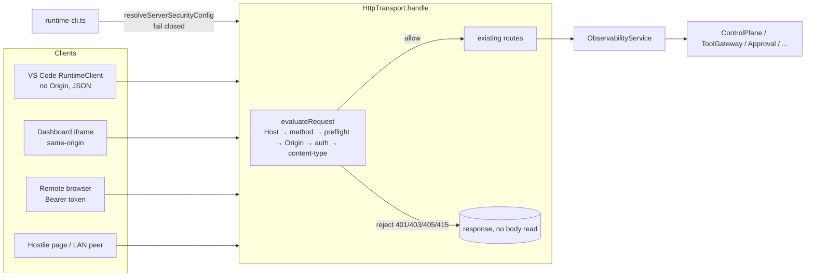

# Design Document: P0 Security Hardening (HTTP runtime + dashboard)

## Overview

The fix is a single security layer in front of the existing HTTP routes, a fail-closed
configuration step in the CLI, and a rewrite of the dashboard's HTML sinks. Nothing behind
`ObservabilityService` changes: ToolGateway, Policy, Approval, TaskGraph, VerificationEngine and
CompletionGate see exactly the same calls as today, and only for requests that already passed the
gate.

Design goals:

1. **Fail closed.** A non-loopback bind without a token is a startup error (CLI) and a `listen`
   error (transport). An unknown Host, a foreign Origin, a missing or wrong token, or a non-JSON
   POST is rejected before routing.
2. **Pure policy, thin transport.** All decisions live in pure functions
   (`observability-server/http-security.ts`) so they can be property-tested without sockets.
   `HttpTransport` only feeds the request metadata in and writes the decision out.
3. **Zero change on loopback.** With the default bind and no token, the VS Code extension
   (`RuntimeClient`: Node fetch, JSON content type, no Origin, `Host: 127.0.0.1:<port>`) and the
   dashboard iframe (same-origin requests) pass every check, so existing tests and workflows keep
   working.
4. **No new dependencies.** `node:crypto` (`createHash`, `timingSafeEqual`) and `node:fs` are
   enough. The dashboard stays a vanilla-JS string asset.

### Files touched

| File | Change |
|---|---|
| `packages/infrastructure/src/observability-server/http-security.ts` | NEW. Pure gate policy: host/origin/token/content-type checks, redaction. |
| `packages/infrastructure/src/observability-server/server-security-config.ts` | NEW. Pure CLI security config resolution (host, token source, allowlists), fail closed. |
| `packages/infrastructure/src/observability-server/http-transport.ts` | Security options, pre-routing gate, CORS rewrite, redaction, generic 500, static headers. |
| `packages/infrastructure/src/observability-server/index.ts` | Export the two new modules. |
| `packages/infrastructure/src/cli/runtime-cli.ts` | `--host`, `--auth-token-file`, `--allowed-hosts`, `--allowed-origins`, env token, banner, usage; replace `listen(port, '0.0.0.0')`. |
| `packages/infrastructure/src/observability-server/dashboard-assets.ts` | Token form, `api()` fetch wrapper, fetch-based SSE, sink rewrite. |
| `tests/observability-server/http-security.spec.ts` | NEW. |
| `tests/observability-server/server-security-config.spec.ts` | NEW. |
| `tests/observability-server/dashboard-auth.spec.ts` | NEW. |
| `tests/observability-server/dashboard-xss.spec.ts` | Extended (already exists, currently failing). |

`runtime-cli.ts` is a standalone script (its barrel exports nothing), so the CLI config logic is
placed in `observability-server/` where tests can import it from `@codeforge/infrastructure`. Both
new modules depend only on `node:` built-ins, so dependency-cruiser boundaries are unchanged.

## Architecture



The gate runs once per request, before `readBody` and before any route branch. A rejected request
produces a response from the gate decision only; `ObservabilityService` is never touched.

## Components and Interfaces

### C1. `http-security.ts` (pure policy)

```typescript
export interface SecurityPolicy {
  /** Exact `host:port` values accepted in the Host header (lowercased). */
  readonly allowedHosts: ReadonlySet<string>;
  /** Exact origins (scheme://host[:port], lowercased) allowed cross-origin. Empty by default. */
  readonly allowedOrigins: ReadonlySet<string>;
  /** When defined, Protected_Route requests need `Authorization: Bearer <authToken>`. */
  readonly authToken?: string;
}

export interface RequestMeta {
  readonly method: string;
  readonly path: string;
  readonly host: string | undefined;          // req.headers.host
  readonly origin: string | undefined;        // req.headers.origin
  readonly authorization: string | undefined; // req.headers.authorization
  readonly contentType: string | undefined;   // req.headers['content-type']
}

export type GateDecision =
  | { readonly kind: 'allow'; readonly corsOrigin?: string }       // corsOrigin → ACAO + Vary
  | { readonly kind: 'preflight'; readonly corsOrigin: string }    // 204 + allow headers
  | { readonly kind: 'reject'; readonly status: 401 | 403 | 405 | 415; readonly error: string;
      readonly wwwAuthenticate?: boolean };

export const PUBLIC_ROUTES: ReadonlySet<string>; // 'GET /', 'GET /app.js', 'GET /health'

export function isLoopbackAddress(host: string): boolean;     // 127.0.0.0/8, ::1, localhost
export function isWildcardAddress(host: string): boolean;     // 0.0.0.0, ::
export function buildAllowedHosts(bindHost: string, port: number, extra: readonly string[]): ReadonlySet<string>;
export function normalizeOrigin(value: string): string | null; // http/https origin or null
export function isJsonContentType(value: string | undefined): boolean;
export function tokensEqual(presented: string, expected: string): boolean;
export function extractBearer(header: string | undefined): string | null;
export function evaluateRequest(meta: RequestMeta, policy: SecurityPolicy): GateDecision;
export function redactSecret(text: string, secret: string | undefined): string;
```

Decision order in `evaluateRequest` (first failing check wins, Requirement 7.3):

| # | Check | Reject |
|---|---|---|
| 1 | `host` (lowercased) ∈ `allowedHosts` | 403 `host not allowed` |
| 2 | method ∈ {GET, POST, OPTIONS} | 405 `method not allowed` |
| 3 | `OPTIONS`: origin normalized ∈ `allowedOrigins` → `preflight` | 403 `origin not allowed` |
| 4 | public route → `allow` (no Origin/auth check; navigation and `<script src>` carry no data) | — |
| 5 | origin absent → continue; origin === `http://<host>` (Same_Origin) → continue; origin ∈ `allowedOrigins` → continue with `corsOrigin` | 403 `origin not allowed` |
| 6 | `authToken` defined → `extractBearer` + `tokensEqual` | 401 `unauthorized` + `WWW-Authenticate: Bearer` |
| 7 | `POST` → `isJsonContentType` | 415 `content-type must be application/json` |
| 8 | `allow` | — |

Details:

- `buildAllowedHosts` always adds `127.0.0.1:<port>`, `localhost:<port>`, `[::1]:<port>`; adds
  `<bindHost>:<port>` when the bind host is a specific address (IPv6 wrapped in brackets); adds each
  `extra` hostname with the port. Wildcard binds add nothing implicit, so `--host 0.0.0.0` requires
  `--allowed-hosts` for browsers that reach the server through a LAN name or IP.
- `tokensEqual` hashes both strings with SHA-256 and compares the two 32-byte digests with
  `crypto.timingSafeEqual`. Equal-length digests remove the length side channel and the
  `RangeError` that `timingSafeEqual` throws on different lengths.
- `extractBearer` accepts exactly `Bearer <token>` (scheme case-insensitive, one space, token without
  whitespace). The query string is never inspected, so `?token=` or `?access_token=` has no effect.
- `isJsonContentType` takes the part before `;`, trims and lowercases it, and compares with
  `application/json`.
- `redactSecret` returns `text.split(secret).join('[redacted]')` when `secret` is non-empty.

### C2. `HttpTransport` changes

```typescript
export interface HttpTransportOptions {
  readonly service: ObservabilityService;
  readonly streamPollMs?: number;
  /** Shared bearer token. When set, Protected_Route requests require it. */
  readonly authToken?: string;
  /** Force auth even on loopback. Default: true when authToken is set. Requires authToken. */
  readonly requireAuth?: boolean;
  /** Extra Host header hostnames (no port) accepted besides the loopback names. */
  readonly allowedHosts?: readonly string[];
  /** Exact cross-origin origins allowed (CORS + Origin check). Default: none. */
  readonly allowedOrigins?: readonly string[];
}
```

- `listen(port = 0, host = '127.0.0.1')`:
  - rejects with `Error('auth token required to bind non-loopback host <host>')` when
    `!isLoopbackAddress(host) && authToken === undefined` (Requirement 1.4), and when
    `requireAuth === true && authToken === undefined`;
  - rejects when an `allowedOrigins` entry fails `normalizeOrigin` or equals `*`;
  - after the server is bound, builds the `SecurityPolicy` with the real port (port 0 in tests)
    and stores it. Requests can only arrive after the bind, so the policy is always present when
    `handle` runs.
- `handle(req, res)`:
  1. Build `RequestMeta` from headers and the parsed path (no body access).
  2. `decision = evaluateRequest(meta, policy)`.
  3. `reject` → `sendJson(status, { error })` (plus `WWW-Authenticate: Bearer` for 401) and return.
     `preflight` → 204 with `Access-Control-Allow-Origin: <origin>`, `Vary: Origin`,
     `Access-Control-Allow-Methods: GET, POST, OPTIONS`,
     `Access-Control-Allow-Headers: authorization, content-type`, `Access-Control-Max-Age: 600`.
     `allow` with `corsOrigin` → set `Access-Control-Allow-Origin: <origin>` and `Vary: Origin`.
  4. Existing routing, unchanged. The old `Access-Control-Allow-Origin: *` block and the
     unconditional `OPTIONS → 204` are removed.
- `sendJson` redacts every string value of the body through `redactSecret` when `status >= 400`.
  `streamModelPull` redacts the `error` field of its SSE error frame.
- The outer `catch` responds `500 { error: 'internal error' }` instead of `err.message`.
- `sendHtml` / `sendJs` add `X-Content-Type-Options: nosniff` and
  `Content-Security-Policy: default-src 'self'; script-src 'self'; style-src 'self' 'unsafe-inline';
  img-src 'self' data:; connect-src 'self'; object-src 'none'; base-uri 'none'; form-action 'self'`.
  No `frame-ancestors` directive: the VS Code webview (`vscode-webview://`) embeds the page in an
  iframe and must keep doing so. The dashboard already uses only `<script src="/app.js">` and
  property-assigned handlers, so `script-src 'self'` does not break it; inline `style` attributes
  are covered by `'unsafe-inline'` for styles.

### C3. `server-security-config.ts` (CLI config, pure)

```typescript
export interface ServerSecurityInput {
  readonly host?: string;            // --host
  readonly authTokenFile?: string;   // --auth-token-file
  readonly allowedHosts?: string;    // --allowed-hosts a,b
  readonly allowedOrigins?: string;  // --allowed-origins https://x,https://y
  readonly env: Readonly<Record<string, string | undefined>>;
  readonly readFile: (path: string) => string; // injected; real CLI passes fs.readFileSync utf8
}

export interface ServerSecurityConfig {
  readonly host: string;             // default '127.0.0.1'
  readonly authToken?: string;
  readonly allowedHosts: readonly string[];
  readonly allowedOrigins: readonly string[];
  readonly authRequired: boolean;
}

export class ServerSecurityConfigError extends Error {} // message never contains the token

export const AUTH_TOKEN_MIN_LENGTH = 16;
export function resolveServerSecurityConfig(input: ServerSecurityInput): ServerSecurityConfig;
export function describeServerSecurity(cfg: ServerSecurityConfig, port: number): string[]; // banner lines
```

Resolution rules (Requirements 1, 2, 4.3, 5.7):

| Condition | Result |
|---|---|
| `host` absent or empty | `127.0.0.1` |
| `CODEFORGE_AUTH_TOKEN` non-empty and `authTokenFile` set | error: one token source only |
| `authTokenFile` set, read throws | error naming the path (not the cause text, which can quote content) |
| file content trimmed is empty | error naming the path |
| token length < 16 | error stating the minimum |
| host not loopback and no token | error: `--host <host> requires an auth token (CODEFORGE_AUTH_TOKEN or --auth-token-file)` |
| `allowedOrigins` entry `*` or not an `http(s)` origin | error naming the entry |
| otherwise | config; `authRequired = authToken !== undefined` |

`runtime-cli.ts` changes:

- `parseArgs` already handles `--key value`; the new keys are read from `args`.
- `resolveServerSecurityConfig` runs at the top of `main()`, before the DB, model gateway or
  workspace lock is opened, so a misconfiguration exits with code 1 and no side effects.
- `new HttpTransport({ service, streamPollMs: 300, authToken, allowedHosts, allowedOrigins })`
  and `http.listen(port, cfg.host)` replace `http.listen(port, '0.0.0.0')`.
- The banner prints `describeServerSecurity` lines, e.g.
  `  Bind:       127.0.0.1:9500 (loopback)` and `  Auth:       off (loopback only)` or
  `  Auth:       ON (bearer token from CODEFORGE_AUTH_TOKEN)`. The dashboard URL uses
  `localhost` for loopback binds and the bind host otherwise.
- The header comment / usage lists `--host`, `--auth-token-file`, `--allowed-hosts`,
  `--allowed-origins` and `CODEFORGE_AUTH_TOKEN`. `--api-key` / `CODEFORGE_API_KEY` stay the provider
  key; there is no `--auth-token <value>` flag.

### C4. Dashboard (`dashboard-assets.ts`)

#### Token handling

- `DASHBOARD_HTML` gains a hidden form in the header:
  `<form id="authForm" hidden><label for="authToken">Access token</label>
  <input id="authToken" type="password" autocomplete="off" />
  <button type="submit">Unlock</button><span id="authStatus" role="status" aria-live="polite"></span></form>`.
- `DASHBOARD_JS` gains:

```javascript
var TOKEN_KEY = "codeforge.authToken";
var authToken = readStoredToken();          // sessionStorage only, try/catch guarded
function authHeaders(extra) {               // merges { authorization: "Bearer " + authToken }
  var h = {}; for (var k in (extra || {})) h[k] = extra[k];
  if (authToken) h["authorization"] = "Bearer " + authToken;
  return h;
}
function api(path, init) {                  // every fetch in the script goes through api()
  init = init || {};
  init.headers = authHeaders(init.headers);
  return fetch(path, init).then(function (r) {
    if (r.status === 401) { onUnauthorized(); }
    return r;
  });
}
```

- `onUnauthorized()` clears the in-memory and `sessionStorage` token, shows `#authForm`, and sets
  `#authStatus` text. Submitting the form stores the token, hides the form, and re-runs
  `loadConfig()`, `refreshModels()`, `captureBaseline()` and `connect()` when a session is selected.
- The token never enters a URL, `localStorage` or `document.cookie`.

#### Live stream (`/stream`)

```javascript
function openStream(sid) {
  if (!authToken) return openEventSource(sid);   // unchanged behaviour on loopback
  return openFetchStream(sid);
}
```

`openFetchStream` calls `api("/stream?session=…&from=" + lastSeq, { signal })`, reads
`r.body.getReader()`, decodes with `TextDecoder` (`{ stream: true }`), splits on blank lines, takes
`id:` and `data:` fields, updates `lastSeq` from `id`, and hands each parsed event to the same
`onEvent` handler `EventSource.onmessage` uses. On end or network error it sets status
`"stream error"` and reconnects after 2 s from `lastSeq`; a 401 stops reconnecting and shows the
token form. `connect()` aborts the previous stream through its `AbortController`. `/models/pull`
already uses fetch + reader and only switches to `api()`.

#### Output encoding

Helpers (context-specific, not one universal escaper):

```javascript
function el(tag, cls, text) {             // createElement + className + textContent
  var n = document.createElement(tag);
  if (cls) n.className = cls;
  if (text !== undefined && text !== null) n.textContent = String(text);
  return n;
}
function escText(s) {                     // HTML text context: & < >
  return String(s).replace(/&/g, "&amp;").replace(/</g, "&lt;").replace(/>/g, "&gt;");
}
function escAttr(s) {                     // quoted attribute context: & < > " '
  return escText(s).replace(/"/g, "&quot;").replace(/'/g, "&#39;");
}
function safeClass(value, allowed, fallback) {   // allowlisted class tokens only
  return Object.prototype.hasOwnProperty.call(allowed, value) ? value : fallback;
}
function safeUrl(u) {                     // relative, http, https; everything else → ""
  var s = String(u).trim();
  if (/^[a-z][a-z0-9+.-]*:/i.test(s)) return /^https?:/i.test(s) ? s : "";
  return s;
}
function clear(node) { node.textContent = ""; }
```

Class allowlists: `TASK_STATE_CLASS` (PENDING, READY, RUNNING, VERIFYING, PASSED, BLOCKED, FAILED,
plus the existing CSS names), `CHANGE_KIND_CLASS` (write, edit, delete, shell, …, from the CSS in
`DASHBOARD_HTML`), `GOV_LEVEL_CLASS`. Unknown values fall back to a neutral class (`k`, `s-unknown`).

Sink inventory and fix (line numbers from the audit):

| Line(s) | Renderer | Untrusted data | Fix |
|---|---|---|---|
| ~240/241 | `#agentState` `kv()` | session state, model, provider, counts | `el()` rows, `textContent` |
| 293, 304 | `#governance` | MISSION_* payloads (LLM), event types, `at` | build rows with `el()`; `gesc` removed |
| 320, 325, 327 | `#changes` | toolName, kind (attribute injection in `class='k …'`), path, summary, diff | `el()`, `safeClass(kind)`, diff lines as text nodes with `+`/`-` line classes |
| 359 | `#taskGraph` | taskId, state, dependsOn | `el()`, `safeClass(state)` |
| 423, 440, 442 | approval banner (`abDetail`) | toolCallId, toolName, path, summary | `el()` / `textContent`; static label text stays literal |
| 513 | `#files` | `f.path`, `f.sizeBytes` | `el()`; size via `Number()` and formatting |
| 561, 584 | `#activity` (`insertAdjacentHTML`) | event type, time, summary | `appendChild(el(...))` |
| 622 | `#chatLog` | `g.sessionId` (data-sid + text), `g.at`, goal text | `el()`; `dataset.sid` / `setAttribute('data-sid')`; listener attached directly to the element (no `querySelectorAll` rebinding) |
| 722 | `#modelSelect` | model names | `new Option`-style: `createElement('option')`, `.value`, `.textContent` |
| 731, 743 | model errors | error strings | `textContent` |
| 735 | `#models` list | name, parameterSize, quantization | `el()` |
| activity time | activity line | `at` | `textContent` |

Where a renderer keeps a fixed HTML template (static structure with no data), the template stays a
string literal; any interpolated value uses `escText` for text and `escAttr` for quoted attributes.
`esc`, `esc2`, `gesc` are removed once no caller remains.

## Data Models

No persisted data changes. New in-memory structures only: `SecurityPolicy`, `GateDecision`,
`ServerSecurityConfig`, and the dashboard's `authToken` (memory + `sessionStorage`) and `lastSeq`.

## Error Handling

| Situation | Response |
|---|---|
| Host not allowed / absent | 403 `{ "error": "host not allowed" }` |
| Method not GET/POST/OPTIONS | 405 `{ "error": "method not allowed" }` |
| Preflight from non-allowlisted / missing Origin | 403 `{ "error": "origin not allowed" }`, no CORS headers |
| Foreign Origin on a protected route | 403 `{ "error": "origin not allowed" }` |
| Missing / invalid bearer token | 401 `{ "error": "unauthorized" }`, `WWW-Authenticate: Bearer` |
| POST without JSON content type | 415 `{ "error": "content-type must be application/json" }` |
| Unexpected exception in a route | 500 `{ "error": "internal error" }` |
| Expected 501 messages (`/config/model`, `/goal`, `/models`) | unchanged text, passed through `redactSecret` |
| CLI misconfiguration | `ServerSecurityConfigError` printed as `Error: <message>`, exit code 1, before any side effect |
| `listen` with non-loopback host and no token | rejected promise; server not bound |

## Design Decisions

### D1. Remote SSE: fetch streaming with `Authorization` (chosen)

`EventSource` cannot set request headers, and tokens in URLs are forbidden (they leak into logs,
history and `Referer`). When a token is in use, the dashboard reads `/stream` with `fetch` and a
`ReadableStream` reader, which sends the same `Authorization: Bearer` header as every other request.
No cookies are involved, so no ambient credential exists and CSRF stays limited to the
content-type + Origin checks. The token is typed by the user and kept in memory and
`sessionStorage` (per tab, cleared when the tab closes). Without a token (loopback default), the
dashboard keeps using `EventSource`, so the local behaviour is unchanged.

### D2. HttpOnly `SameSite=Strict` session cookie (rejected for P0, deferred)

A cookie would let `EventSource` and plain navigation authenticate, but it adds a login endpoint,
session issuance and expiry, cookie flags that depend on TLS (`Secure`), and an ambient credential
that brings back CSRF for every route. That is new surface, not hardening. It can be reconsidered in
P1 together with TLS.

### D3. Static assets and `/health` stay public under auth

A browser navigation to `/` and the `<script src="/app.js">` load cannot carry an `Authorization`
header, and URL tokens are forbidden. Both assets are constant strings with no runtime data and no
credentials (asserted by a test), and `/health` returns only `{ ok: true }`. They are still subject
to Host validation and served with CSP and `nosniff`. Every data and control route requires the
token.

### D4. Host allowlist instead of bind-address inference

DNS rebinding makes a hostile name resolve to `127.0.0.1`; the only reliable signal is the Host
header. Loopback names with the bound port are always allowed; anything else must be configured. A
wildcard bind adds no implicit names.

### D5. Same-origin by Host, not by bind address

Same_Origin is `Origin === "http://" + Host` after the Host check. This covers the dashboard
iframe in VS Code (`http://127.0.0.1:<port>`) and a browser on `localhost:<port>`. A TLS reverse
proxy in front of the runtime changes the scheme; the operator lists that origin in
`--allowed-origins`.

### D6. Extension stays tokenless

The extension launches the runtime itself on loopback without a token, so it needs no change.
Passing a token from the extension is P1.

## Correctness Properties

*A property is a characteristic or behavior that should hold true across all valid executions of a
system-essentially, a formal statement about what the system should do. Properties serve as the
bridge between human-readable specifications and machine-verifiable correctness guarantees.*

The tests for these properties use the repository's seeded generator style (`mulberry32`, as in
`tests/mission/clarification-generators.ts`); no property-testing dependency is added. Each property
test runs at least 100 seeded iterations and carries the tag
`// Feature: p0-security-hardening, Property N: <title>`.

### Property 1: Gate decision matches the reference order

For any request metadata (generated Host values including absent, other ports, rebinding names and
case variants; methods including PUT/DELETE; Origin absent, same-origin, allowlisted, foreign and
`null`; Authorization absent, malformed, wrong scheme, wrong token, correct token, and tokens placed
in the query string; content types JSON, JSON with parameters, mixed case, `text/plain`, form,
multipart and absent; public and protected paths) and any policy (with and without token, with and
without allowlisted origins), `evaluateRequest` returns the same decision as an independent
reference implementation of the ordered checks Host → method → preflight → public route → Origin →
auth → content type.

**Validates: Requirements 3.1, 3.2, 3.4, 3.5, 3.6, 4.1, 4.2, 5.3, 5.4, 5.5, 5.6, 6.1, 6.2, 6.3, 6.4, 7.3**

### Property 2: Token comparison is exact

For any expected token and any presented string (equal, prefix, extension, one-character change,
different length, empty, non-ASCII), `tokensEqual(presented, expected)` returns `true` exactly when
the two strings are equal, and never throws.

**Validates: Requirements 3.2, 3.3**

### Property 3: No wildcard CORS

For any request accepted or rejected by a running `HttpTransport`, the response either has no
`Access-Control-Allow-Origin` header or has one equal to an origin in Allowed_Origin_Set together
with `Vary: Origin`; the value is never `*`.

**Validates: Requirements 5.1, 5.2**

### Property 4: Rejected requests never reach the service

For any request that the gate rejects (generated across every route, including `/stream`,
`/models/pull`, `/control`, `/goal`, `/clarification`, `/plan-choice`, `/config/model`), sent to a
real `HttpTransport` backed by a spy `ObservabilityService`, the response status is 401, 403, 405 or
415 and the spy records zero method calls.

**Validates: Requirements 7.1, 7.2**

### Property 5: Error output never contains the token

For any token of at least 16 characters and any error text that embeds the token zero or more times
at any position, `redactSecret(text, token)` contains no occurrence of the token, and text without
the token is returned unchanged.

**Validates: Requirements 8.1**

### Property 6: Configuration fails closed

For any host value (loopback forms, wildcard, LAN IPv4/IPv6, hostnames, empty) and any token source
combination (none, env, file, both, empty, short), `resolveServerSecurityConfig` throws
`ServerSecurityConfigError` exactly when the inputs violate a rule in the C3 table; otherwise it
returns a config whose host defaults to `127.0.0.1` and whose `authRequired` equals "a token is
present", and no error message contains the token value.

**Validates: Requirements 1.1, 1.2, 1.3, 2.1, 2.2, 2.3, 2.5, 8.3**

## Testing Strategy

### `tests/observability-server/http-security.spec.ts`

- Property tests 1–5 (pure functions; 3 and 4 against a real `HttpTransport` on `listen(0)` with a
  spy service built from the in-memory/fake ports used in `http-transport.spec.ts`).
- Examples:
  - default `listen(0)` binds `127.0.0.1` (address check);
  - `listen(0, '0.0.0.0')` without token rejects; with token resolves;
  - 401 on `/state`, `/control`, `/goal` without and with a wrong token; 200/202 with the right one;
  - `/` and `/app.js` reachable without token under auth; asset text contains no token, no
    `Bearer ` literal with a value, no `api-key`/`password` assignments;
  - foreign Origin → 403 on `POST /control` and `GET /state`; allowlisted origin → exact ACAO;
  - preflight allowed/denied;
  - `POST /goal` with `text/plain` → 415, service untouched;
  - bad Host (`evil.example:port`, `127.0.0.1:<other port>`) → 403 on `/`, `/health`, `/state`;
  - a service method throwing `Error('boom ' + token)` → 500 `{ error: 'internal error' }`;
    a 501 message containing the token → redacted;
  - static responses carry CSP and `nosniff`.

### `tests/observability-server/server-security-config.spec.ts`

Property 6 plus examples: default host; env token; trimmed file token; both sources; unreadable
file (error message has the path, not the content); `--allowed-origins *`; banner lines contain
host/port/auth state and never the token.

### `tests/observability-server/dashboard-xss.spec.ts` (extended)

Runs the real `DASHBOARD_JS` in the existing stub DOM (no jsdom). The stub additionally records
every `textContent` write, `className`, `setAttribute` and created element so the test can assert:

- no HTML sink receives a payload tag, `on*` attribute or `javascript:` URL (existing scan);
- every `className` assigned from data is in the allowlists (attribute injection via `kind`/`state`);
- no `href`/`src` attribute holds a non-http(s) scheme;
- the payload strings appear verbatim as text (proves the renderers ran; replaces the
  `sinks.length > 5` guard, which no longer holds once sinks become DOM calls).

Payload corpus: HTML injection (`"'>`), attribute breakout
(`' onmouseover='alert(2)' x='`), `javascript:alert(3)`, `<script>`, `<iframe srcdoc>`, `<svg onload>`,
delivered through LLM output (MISSION_* payloads, task ids, plan text), workspace file names, file
content (diffs), tool arguments and results (`/changes`, approval banner), session metadata
(`/state`, `/sessions`, `/config`), model names, and error messages (`/goal`, `/models`, `/config/model`).

### `tests/observability-server/dashboard-auth.spec.ts`

Runs `DASHBOARD_JS` with a fake fetch that answers 401 until a token is supplied: token form shown;
after submit every fetch carries `authorization: Bearer <t>`; no request URL contains the token;
`localStorage` untouched; `/stream` read through fetch (FakeEventSource never constructed) and
reconnect uses `from=<lastSeq>`; a later 401 clears `sessionStorage` and shows the form; without a
token `/stream` uses `EventSource`.

### Compatibility

Existing suites listed in Requirement 11.4 run unchanged. One added example in
`http-security.spec.ts` replays the exact request shapes of `RuntimeClient` (Node fetch, JSON, no
Origin, Host `127.0.0.1:<port>`) and of the dashboard iframe (same-origin `Origin`) against a
loopback, tokenless transport and expects the normal route responses.
