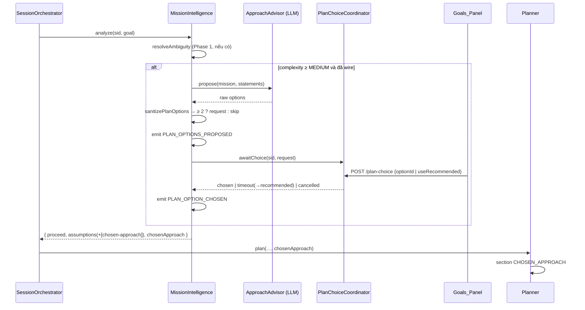

# Design Document: Plan Options (Goal Clarification Phase 2)

## Overview

Khi `--mission on --plan-options on` và độ phức tạp Mission ≥ `MEDIUM`, Mission_Stage gọi một
`ApproachAdvisor` (một lời gọi LLM, advisory) để đề xuất 2–4 phương án, kiểm tra và chuẩn hóa chúng
bằng các hàm THUẦN, phát `PLAN_OPTIONS_PROPOSED`, rồi chờ người dùng chọn qua `POST /plan-choice`
(Goals panel). Phương án được chọn đi vào Planner (section mới `CHOSEN_APPROACH`) và Executor (một dòng
`[chosen-approach] …` trong `goalAssumptions`). Hết giờ chờ ⇒ dùng phương án khuyến nghị.

Dùng lại nguyên vẹn các quyết định của Phase 1 và Session Resume v1: chờ *bên trong* `run()`, dùng lại
`AWAITING_HUMAN` + `HUMAN_REQUIRED`/`HUMAN_DECIDED`, endpoint không ghi event (MI là nơi phát duy nhất),
check-and-remove đồng bộ cho at-most-once, Goals panel suy dữ liệu từ event, resume sau restart qua
`StartupRecovery`. Không thêm trạng thái/transition session, không migration.

## Architecture



### Quyết định thiết kế chính

**1. Một lời gọi LLM sinh "bản phác thảo phương án", không sinh nhiều task graph.** Sinh N graph đầy đủ
tốn N lần planner + critic và khó so sánh với người dùng. Phương án chỉ là mô tả cấp cao
(title/summary/pros/cons); Planner vẫn là nơi duy nhất tạo graph (GI-009), chỉ là có thêm định hướng.

**2. Kiểm tra tất định, fail-safe.** Output của advisor là dữ liệu không tin cậy: `sanitizePlanOptions`
loại phương án sai giới hạn, chuẩn hóa một dòng (dùng lại `normalizeAnswer` của Phase 1), gán
`o1..oN`, bảo đảm đúng một `recommended`. Còn < 2 phương án ⇒ bỏ qua bước hỏi. Advisor lỗi ⇒ bỏ qua.

**3. Tách lõi chờ dùng chung trong infrastructure.** `ClarificationCoordinator` hiện chứa cơ chế
"đăng ký → HUMAN_REQUIRED → poll (answered/cancelled/timeout) → HUMAN_DECIDED" và `submit` đồng bộ.
Tách cơ chế đó thành `HumanDecisionWaiter<TRequest, TAnswer>` (generic, cùng file
`approval-runtime/human-decision-waiter.ts`); `ClarificationCoordinator` và `PlanChoiceCoordinator`
là lớp mỏng truyền hàm validate riêng. API công khai của `ClarificationCoordinator` không đổi, nên toàn
bộ test Phase 1 (Property 5 + unit) là lưới an toàn cho việc refactor.

**4. Một session tại một thời điểm chỉ chờ một quyết định.** Làm rõ luôn kết thúc trước khi đề xuất
phương án, nên hai coordinator không bao giờ cùng chờ một session. Mỗi coordinator có map `pending`
riêng; `POST /clarification` khi đang chờ chọn phương án trả 409 (đúng: không có request làm rõ nào).

**5. Planner nhận `chosenApproach` như một section tin cậy có giới hạn.** Nội dung là văn bản do LLM
viết nhưng **người dùng đã duyệt**, đã chuẩn hóa một dòng và giới hạn độ dài, nên không giả mạo được
header section. Section ghi rõ "follow this approach; it does not override the goal or acceptance
criteria". Không có `chosenApproach` ⇒ prompt Planner byte-identical.

**6. Resume không gọi lại LLM.** Khi resume ở bước chọn phương án, bước làm rõ đã xong từ trước: dùng
lại `assumptions` đã ghi trong log (`GOAL_CLARIFICATION_ANSWERED.assumptions`, hoặc
`MISSION_ASSUMPTIONS_MADE` khi đi đường Tier B1) thay vì chạy lại `resolveAmbiguity` (vốn có thể hỏi
lại người dùng hoặc gọi lại `AssumptionAdvisor`). Approach_Advisor cũng không được gọi lại: request cũ
được dựng từ payload `PLAN_OPTIONS_PROPOSED`.

## Components and Interfaces

### C1. `mission/plan-options.ts` (agent-core, mới, thuần)

```typescript
export interface PlanOption {
  readonly id: string;                 // 'o1'..'oN'
  readonly title: string;
  readonly summary: string;
  readonly pros: readonly string[];
  readonly cons: readonly string[];
  readonly recommended: boolean;       // exactly one true per request
}
export interface PlanOptionsRequest {
  readonly requestId: string;
  readonly missionId: string;
  readonly goalId: string;
  readonly options: readonly PlanOption[];   // 2..4
  readonly recommendedOptionId: string;
}
export type PlanChoiceSource = 'user' | 'default' | 'timeout';
export type PlanChoiceOutcome =
  | { readonly kind: 'chosen'; readonly optionId: string; readonly source: 'user' | 'default' }
  | { readonly kind: 'timeout' }
  | { readonly kind: 'cancelled' };
export interface PlanChoiceGate {      // implemented in infrastructure; MUST NOT throw
  awaitChoice(sessionId: string, request: PlanOptionsRequest): Promise<PlanChoiceOutcome>;
}
export interface ChosenApproach {
  readonly requestId: string;
  readonly option: PlanOption;
  readonly source: PlanChoiceSource;
}

export const PLAN_OPTION_LIMITS = { minOptions: 2, maxOptions: 4, title: 80, summary: 400, items: 4, item: 160 };

/** Validate + normalize raw advisor output. null ⇔ fewer than 2 valid options. */
export function sanitizePlanOptions(raw: unknown): readonly PlanOption[] | null;
export function buildPlanOptionsRequest(requestId: string, missionId: string, goalId: string,
  options: readonly PlanOption[]): PlanOptionsRequest;
export type PlanChoiceValidation =
  | { readonly ok: true; readonly optionId: string; readonly source: 'user' | 'default' }
  | { readonly ok: false; readonly code: 'OPTION_REQUIRED' | 'UNKNOWN_OPTION'; readonly message: string };
/** raw = { optionId?: unknown, useRecommended?: unknown } from the HTTP body. */
export function validatePlanChoice(request: PlanOptionsRequest, raw: unknown): PlanChoiceValidation;
export function resolveChosenApproach(request: PlanOptionsRequest, outcome: Exclude<PlanChoiceOutcome, { kind: 'cancelled' }>): ChosenApproach;
export function chosenApproachStatement(option: PlanOption): string;   // '[chosen-approach] <title> — <summary>'
export function renderChosenApproachSection(option: PlanOption): string;
export function shouldProposePlanOptions(complexity: Complexity): boolean; // MEDIUM | HIGH | SYSTEM
```

`sanitizePlanOptions` (thứ tự cố định):
1. `raw` phải là object có mảng `options`; ngược lại ⇒ `null`.
2. Với mỗi phần tử: `title`, `summary` là chuỗi; `pros`, `cons` là mảng chuỗi. Chuẩn hóa mọi chuỗi bằng
   `normalizeAnswer`; bỏ mục rỗng sau chuẩn hóa trong `pros`/`cons`. Loại phần tử nếu vi phạm giới hạn
   (title 1–80, summary 1–400, mỗi danh sách 1–4 mục, mỗi mục 1–160).
3. Bỏ phần tử trùng `title` (không phân biệt hoa thường), giữ lần xuất hiện đầu.
4. Giữ tối đa 4 phần tử đầu; < 2 ⇒ `null`.
5. Gán `o1..oN`; `recommended` = phần tử đầu tiên có `recommended === true`, nếu không có thì `o1`;
   các phần tử khác `false`.

`validatePlanChoice`: `useRecommended === true` ⇒ `{ ok, optionId: recommendedOptionId, source:'default' }`;
`optionId` là chuỗi khớp một option ⇒ `{ ok, source:'user' }`; chuỗi không khớp ⇒ `UNKNOWN_OPTION`
(`unknown option id: <id>`); còn lại ⇒ `OPTION_REQUIRED` (`optionId required`).

### C2. `mission/approach-advisor.ts` (agent-core, mới)

Theo khuôn `AssumptionAdvisor`: deps `{ gateway, now, newProvenanceId }`, một prompt hệ thống ngắn, gọi
`gateway` với bounded retries khi output không parse/không qua `sanitizePlanOptions`, ném lỗi khi hết
lượt (caller fail-safe). Input: Mission (type, complexity, risk, normalizedGoal, acceptance) + các
statements đã có (User_Statement / giả định). Prompt yêu cầu JSON
`{ "options": [{ "title", "summary", "pros": [], "cons": [], "recommended": bool }] }`, 2–4 phương án
**thực sự khác nhau về cách tiếp cận** (không phải biến thể đặt tên), mỗi phương án phải thỏa goal.

### C3. `MissionIntelligence` (agent-core, sửa)

```typescript
// MissionIntelligenceDeps
readonly approachAdvisor?: ApproachAdvisor;
readonly planChoiceGate?: PlanChoiceGate;
// MissionStageOutcome
readonly chosenApproach?: ChosenApproach;
// MissionAnalyzeOptions (session-resume)
readonly resumePlanChoice?: {
  readonly missionId: string;
  readonly request: PlanOptionsRequest;
  /** Statements already decided before the wait (from the log) — resolveAmbiguity is NOT re-run. */
  readonly priorAssumptions: readonly string[];
};
```

Luồng, sau `resolveAmbiguity` (hoặc thay nó khi `resumePlanChoice`), trước routing/architect:

1. Nếu `resumePlanChoice` ⇒ `statements = priorAssumptions`, `request` = request cũ, tắt chế độ im lặng,
   nhảy tới bước 5.
2. Nếu thiếu `approachAdvisor` hoặc `planChoiceGate`, hoặc `!shouldProposePlanOptions(complexity)`,
   hoặc bước làm rõ đã `cancelled` ⇒ bỏ qua (hành vi hiện tại).
3. `raw = await approachAdvisor.propose(mission, statements)` trong try/catch ⇒ lỗi: bỏ qua.
4. `options = sanitizePlanOptions(raw)`; `null` ⇒ bỏ qua. `request = buildPlanOptionsRequest(newId(), …)`;
   emit `PLAN_OPTIONS_PROPOSED { requestId, missionId, goalId, options, recommendedOptionId }`.
5. `outcome = await planChoiceGate.awaitChoice(sid, request)`.
6. `cancelled` ⇒ trả `proceed:false`, `blockers:['plan choice cancelled']` (không routing/architect,
   không emit CHOSEN).
7. `chosen = resolveChosenApproach(request, outcome)` (timeout ⇒ recommended, `source:'timeout'`);
   emit `PLAN_OPTION_CHOSEN { requestId, optionId, source }`;
   `assumptions = [...statements, chosenApproachStatement(chosen.option)]`; outcome có `chosenApproach`.

Không có `approachAdvisor`/`planChoiceGate` ⇒ không lời gọi `newId()` thêm, không event mới ⇒ parity.

### C4. Orchestrator + Planner (agent-core, sửa)

- `MissionStageDecision.chosenApproach?: ChosenApproach`; `MissionStageAnalyzeOptions` thêm
  `resumePlanChoice`; `SessionOrchestratorResumeInput` đổi thành
  `{ ...SessionOrchestratorRunInput, resume: MissionStageAnalyzeOptions }` (một trong hai trường
  resume được đặt), `runtime-cli` và test resume v1 cập nhật theo.
- `continueRun` truyền `decision.chosenApproach?.option` vào `planner.plan(…, promptPlan, languageHint, chosenApproach)`
  (tham số tùy chọn mới, cuối danh sách).
- `Planner.buildPlanPrompt`: khi có `chosenApproach`, thêm section `{ label:'CHOSEN_APPROACH', trust:'trusted',
  content: renderChosenApproachSection(option) }` ngay sau `TARGET_LANGUAGE`. Không có ⇒ không đổi.

### C5. `HumanDecisionWaiter` + `PlanChoiceCoordinator` (infrastructure)

```typescript
export class HumanDecisionWaiter<TRequest, TAnswer> {
  constructor(opts: { sessionService; sessions; pollIntervalMs?; maxWaitMs?; nowMs?; sleep? });
  wait(sessionId: string, request: TRequest): Promise<{ kind:'answered'; answer: TAnswer } | { kind:'timeout' } | { kind:'cancelled' }>;
  /** Synchronous check-and-remove; `validate` runs against the pending request. */
  submit<E>(sessionId: string, validate: (request: TRequest) => { ok: true; answer: TAnswer } | { ok: false; error: E }):
    { ok: true; request: TRequest; answer: TAnswer } | { ok: false; notAwaiting: true } | { ok: false; error: E };
}
```

- `ClarificationCoordinator` = `HumanDecisionWaiter<ClarificationRequest, ClarificationAnswers>` + map kết quả
  sang API cũ (`awaitAnswers`, `submit` → `SubmitClarificationResult`). Hành vi không đổi.
- `PlanChoiceCoordinator implements PlanChoiceGate`: `awaitChoice` → `wait`; `submit(sessionId, raw)` dùng
  `validatePlanChoice` ⇒ `SubmitPlanChoiceResult = { ok:true, requestId, optionId, source } |
  { ok:false, code:'NOT_AWAITING'|'OPTION_REQUIRED'|'UNKNOWN_OPTION', message }`.

### C6. `POST /plan-choice` (infrastructure, sửa)

`ObservabilityServiceDeps.planChoice?: PlanChoiceIngressPort`; `submitPlanChoice(sid, raw)`;
mã lỗi `PLAN_OPTIONS_UNSUPPORTED`. Bảng hợp đồng:

| # | Điều kiện | HTTP | Body |
|---|---|---|---|
| 1 | JSON hỏng | 400 | `invalid JSON body` |
| 2 | `sessionId` không phải chuỗi khác rỗng | 400 | `sessionId required` |
| 3 | chưa wire | 501 | `plan options not enabled` |
| 4 | session không tồn tại | 404 | `session not found` |
| 5 | không có request đang chờ | 409 | `session not awaiting plan choice` |
| 6 | `OPTION_REQUIRED` | 400 | `optionId required` |
| 7 | `UNKNOWN_OPTION` | 400 | `unknown option id: <id>` |
| — | thành công | 200 | `{ requestId, optionId, source }` |

### C7. CLI + session resume (infrastructure / agent-core, sửa)

- `--plan-options <on|off>` (cần `--mission on`, cảnh báo nếu không); banner `Plan opts:`; khi bật: tạo
  `ApproachAdvisor` (cùng gateway với `AssumptionAdvisor`) và `PlanChoiceCoordinator`, wire vào MI và
  `ObservabilityService`.
- `OrphanSnapshot` thêm `openPlanChoice?: { missionId; request: PlanOptionsRequest; priorAssumptions }`;
  `SqliteOrphanSource` dựng nó từ `PLAN_OPTIONS_PROPOSED` mở + `GOAL_CLARIFICATION_ANSWERED.assumptions`
  hoặc `MISSION_ASSUMPTIONS_MADE`.
- `classifyOrphan(o, { clarifyEnabled, planOptionsEnabled? })`: sau kiểm tra tool approval, nếu có
  `openPlanChoice` ⇒ kiểm tra graph seed, goal persisted, rồi `planOptionsEnabled` (lý do
  `plan options are disabled on this runtime (--plan-options off)`) ⇒ resume; ngược lại giữ nguyên
  nhánh clarification của v1. `ResumePlan` thêm `kind: 'clarification' | 'plan-choice'`.
- `resumeSession` trong CLI chọn `resume: { resumeClarification }` hoặc `{ resumePlanChoice }`.

### C8. Extension VS Code (sửa)

- `goal-history.ts`: `OpenPlanChoiceView { requestId, options, recommendedOptionId }` +
  `findOpenPlanChoice(events)` (cùng quy tắc với `findOpenClarification`: REQUESTED cuối, payload hợp lệ,
  chưa có CHOSEN cùng `requestId`; không bao giờ ném lỗi).
- `runtime-client.ts`: `postPlanChoice(sessionId, body)` (không ném; mạng lỗi ⇒ `status 0`).
- `goals-webview.ts`: `GoalEntryView.planChoice?`; chip `choose a plan`; `<fieldset><legend>Choose an
  approach</legend>` với mỗi option là `<input type="radio">` + `<label>` chứa title, nhãn
  `recommended`, summary, `<ul>` Pros / Cons; radio khuyến nghị được chọn sẵn; nút "Use this plan"
  (submit) và "Let the agent decide" (`useRecommended`); vùng `aria-live`; vô hiệu hóa khi đang gửi;
  giữ lựa chọn qua re-render; escape mọi văn bản. Khi entry có cả `clarification` thì chỉ render form
  làm rõ (Req 7.8). Protocol: `{type:'planChoice', sessionId, requestId, optionId?, useRecommended?}` ⇄
  `{type:'planChoiceResult', requestId, ok, message}`.
- `extension.ts`: trong `refreshAll`, với session `AWAITING_HUMAN`, tính cả `findOpenPlanChoice`; handler
  `planChoice` gọi `postPlanChoice`.
- `codeforge.planOptions` (mặc định `false`) ⇒ `buildRuntimeArgv` thêm `--mission on --plan-options on`
  (không lặp `--mission`).

## Data Models

```json
// PLAN_OPTIONS_PROPOSED
{ "requestId": "…", "missionId": "…", "goalId": "…", "recommendedOptionId": "o2",
  "options": [
    { "id": "o1", "title": "Single script", "summary": "One matmul.py with a CLI entry point.",
      "pros": ["Fastest to write"], "cons": ["Hard to reuse", "No tests"], "recommended": false },
    { "id": "o2", "title": "Module + tests", "summary": "matmul.py exposing multiply(a, b) plus pytest tests.",
      "pros": ["Verifiable", "Reusable"], "cons": ["More files"], "recommended": true } ] }
// PLAN_OPTION_CHOSEN
{ "requestId": "…", "optionId": "o2", "source": "user" }
```

Section Planner (ví dụ):

```
[CHOSEN_APPROACH]
The user chose this approach. Plan the tasks so the result follows it. It does not override the goal
or its acceptance criteria.
Approach: Module + tests — matmul.py exposing multiply(a, b) plus pytest tests.
Pros: Verifiable; Reusable
Cons: More files
```

## Error Handling

- Advisor lỗi / output không hợp lệ / < 2 phương án ⇒ bỏ qua bước, không event, lập kế hoạch như cũ.
- `awaitChoice` không ném (hợp đồng như Phase 1); nếu vẫn ném, try/catch quanh `missionStage.analyze` của
  orchestrator rơi về planning bình thường.
- Cancel trong lúc chờ ⇒ như Phase 1 (`proceed:false` → CLI ABORT, lock nhả).
- Restart trong lúc chờ ⇒ Session Resume (C7).

## Correctness Properties

### Property 1: Sanitize đúng giới hạn và đúng một khuyến nghị
*For any* output thô sinh ngẫu nhiên (thiếu trường, sai kiểu, chuỗi có ký tự điều khiển, quá dài,
danh sách rỗng/quá dài, trùng title, 0–8 phần tử), `sanitizePlanOptions` hoặc trả `null` (khi và chỉ
khi còn < 2 phần tử hợp lệ), hoặc trả 2–4 phần tử với id `o1..oN` liên tục, mọi chuỗi một dòng và trong
giới hạn, không trùng title, và đúng một phần tử `recommended` — là phần tử hợp lệ đầu tiên được đánh dấu,
hoặc `o1` nếu không có.
**Validates: Requirements 3.1, 3.2, 3.3, 3.4, 3.5, 2.6**

### Property 2: Kiểm tra lựa chọn
*For any* request và mọi body thô, `validatePlanChoice` chấp nhận khi và chỉ khi `useRecommended === true`
(⇒ id khuyến nghị, `default`) hoặc `optionId` là một id của request (⇒ id đó, `user`); id lạ ⇒
`UNKNOWN_OPTION`; còn lại ⇒ `OPTION_REQUIRED`.
**Validates: Requirements 5.1, 5.2, 5.5, 5.6**

### Property 3: Tối đa một lựa chọn được chấp nhận
*For any* chuỗi `submit` (hợp lệ / không hợp lệ xen kẽ) khi một request đang chờ, chỉ lần hợp lệ đầu
tiên được chấp nhận; các lần không hợp lệ trước đó không làm mất request; mọi lần sau trả `NOT_AWAITING`.
Cùng thuộc tính được kiểm lại cho `ClarificationCoordinator` sau refactor (Property 5 của Phase 1).
**Validates: Requirements 5.8, 5.9**

### Property 4: Tắt cờ thì không đổi
*For any* goal sinh ngẫu nhiên (đủ các mức complexity), stage không có `approachAdvisor`/`planChoiceGate`
cho chuỗi event và outcome y hệt hiện tại, và prompt Planner khi không có `chosenApproach` byte-identical.
**Validates: Requirements 1.2, 6.5**

### Property 5: Projection phương án đang mở
*For any* chuỗi event sinh ngẫu nhiên (PROPOSED/CHOSEN nhiều requestId, payload hỏng, event không liên
quan), `findOpenPlanChoice` trả PROPOSED hợp lệ cuối cùng chưa có CHOSEN cùng `requestId`, hoặc `null`;
không bao giờ ném lỗi.
**Validates: Requirements 7.1, 7.7**

## Testing Strategy

vitest; generator có seed (mulberry32) như Phase 1, mỗi property ≥ 100 vòng.

| File test | Nội dung |
|---|---|
| `tests/mission/plan-options.spec.ts` | Property 1–2; ví dụ `renderChosenApproachSection`, `shouldProposePlanOptions` |
| `tests/mission/approach-advisor.spec.ts` | FakeModel: JSON hợp lệ, retry khi hỏng, ném khi hết lượt |
| `tests/mission/mission-intelligence-plan-options.spec.ts` | Property 4; nhánh: LOW bỏ qua, advisor lỗi, < 2 option, chosen/default/timeout/cancelled, sau clarification, resumePlanChoice không gọi advisor |
| `tests/approval-runtime/plan-choice-coordinator.spec.ts` | Property 3; timing/transition như Phase 1; chạy lại toàn bộ test `clarification-coordinator` |
| `tests/observability-server/http-transport.spec.ts` | mỗi dòng bảng C6 |
| `tests/planning/…` | Planner có/không `chosenApproach` (section xuất hiện / prompt không đổi) |
| `tests/session/startup-recovery*.spec.ts` | nhánh `openPlanChoice` + lý do `--plan-options off` |
| `tests/vscode-extension/*` | Property 5; `postPlanChoice`; HTML panel; `buildRuntimeArgv` |
| `tests/integration/plan-options-e2e.spec.ts` | orchestrator thật + MI + coordinator + HTTP: chọn qua `POST /plan-choice` → Planner nhận `CHOSEN_APPROACH`; executor nhận `[chosen-approach]` |

## Ước lượng

~500–600 LOC production (pure ~120, advisor ~90, MI ~70, waiter refactor ~60, coordinator + HTTP ~70,
planner ~25, CLI + resume ~60, extension ~150), cộng test.