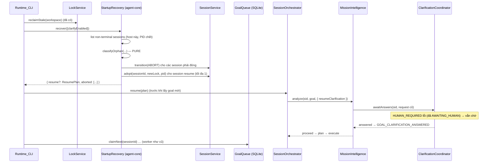

# Design Document: Session Resume (v1 — pre-planning resume)

## Overview

Thiết kế thêm ba thứ vào runtime, đều theo nguyên tắc "kernel quyết định, không thêm authority mới":

1. **Goal queue bền vững**: Goal được ghi vào bảng `goals` có sẵn; một bảng mới `goal_queue`
   (migration 0007) giữ thứ tự FIFO và trạng thái `QUEUED` / `STARTED`.
2. **Startup recovery**: khi khởi động, một bộ phân loại THUẦN quyết định với mỗi session mồ côi là
   `resume` hay `abort`; việc thực hiện đi qua `SessionService` (ABORT hoặc `adopt`).
3. **Resume đường trước planning**: `SessionOrchestrator.resume()` bắt đầu từ `AWAITING_HUMAN`, và
   `MissionIntelligence.analyze()` nhận một tùy chọn `resumeClarification` để chờ lại đúng request
   cũ mà không phát lại các event phân tích.

Không thêm trạng thái session, không thêm transition (Req 7.1). `ClarificationCoordinator`, endpoint
`POST /clarification` và Goals panel không đổi: coordinator đã xử lý trường hợp session đang ở sẵn
`AWAITING_HUMAN` (transition `HUMAN_REQUIRED` thất bại → đọc state → vẫn chờ), còn panel suy câu hỏi
từ event nên tự hiển thị request cũ.

## Architecture

### Luồng khởi động



### Quyết định thiết kế chính

**1. Phân loại là hàm thuần, thực thi đi qua SessionService.** `classifyOrphan()` chỉ đọc một
snapshot (state, metadata, event types, open clarification, graph rỗng hay không, goal đã lưu hay
chưa, cờ clarify). Không I/O, test bằng bảng và property. `StartupRecovery` chỉ là phần nối: đọc port,
gọi hàm thuần, rồi gọi `SessionService` — nơi duy nhất đổi trạng thái session (DC-002).

**2. `SessionService.adopt()` thay vì sửa lock trực tiếp.** Resume cần lock mới (lock cũ đã bị
`reclaimStale` giải phóng; `lock_id` là khóa chính nên không dùng lại được). `adopt` làm đúng ba
việc: `lock.acquire` với `lockId` mới (giữ SS-001: nếu có lock sống, `LOCK_HELD` → không resume),
cập nhật `session.lockId` + `metadata.hostname/processId`, phát `SESSION_ADOPTED`. Trạng thái session
không đổi (vẫn `AWAITING_HUMAN`), nên không cần transition mới.

**3. Resume không phát lại phân tích.** `MissionIntelligence` tính lại các phần tất định (signals,
complexity, risk, uncertainty, context/prompt plan, expert profile — cùng goal ⇒ cùng kết quả, MI-005)
nhưng ở chế độ *im lặng*: không append các event đã có (Req 4.7). Từ điểm chờ trở đi (ANSWERED,
ASSUMPTIONS_MADE, MODEL_SELECTED, architecture) mọi thứ phát event như Phase 1. `missionId` và
`ClarificationRequest` lấy từ payload `GOAL_CLARIFICATION_REQUESTED` để các event sau gắn đúng
aggregate và đúng `requestId`.

**4. Hàng đợi bền vững nhưng `GoalIngressService` vẫn thuần.** Thêm port `GoalQueueStore` (đồng bộ,
như SQLite) vào deps tùy chọn. Có store ⇒ submit/claim đi qua store; không có ⇒ mảng trong bộ nhớ như
hôm nay (test cũ giữ nguyên). `submitGoal` vẫn đồng bộ nên `POST /goal` không đổi.

**5. `claimNext(sessionId)` thay cho `dequeue()`.** Worker sinh `sessionId` trước, rồi claim goal kèm
`sessionId` trong một transaction (Req 1.3): goal chuyển `QUEUED → STARTED` cùng lúc được lấy ra, nên
không chạy hai lần kể cả khi crash ngay sau đó (goal `STARTED` mà không có session sẽ không được chạy
lại — chấp nhận mất một goal hơn là chạy hai lần).

**6. Revision gốc lưu trong `goal_queue`.** Bảng mới có cột `start_revision_hash`, ghi ngay sau khi
`computeWorkspaceRevision` chạy cho session. Khi resume, so hash mới với hash này để đặt
`workspaceChanged` (Req 4.9).

## Components and Interfaces

### C1. Migration 0007 + `SqliteGoalQueueStore` (infrastructure, mới)

```sql
CREATE TABLE goal_queue (
  goal_id              TEXT NOT NULL,
  goal_version         INTEGER NOT NULL,
  workspace_id         TEXT NOT NULL,
  seq                  INTEGER NOT NULL,              -- FIFO order (monotonic per DB)
  status               TEXT NOT NULL CHECK (status IN ('QUEUED','STARTED')),
  enqueued_at          TEXT NOT NULL,
  session_id           TEXT,                          -- set on claim
  started_at           TEXT,
  start_revision_hash  TEXT,
  PRIMARY KEY (goal_id),
  FOREIGN KEY (goal_id, goal_version) REFERENCES goals (goal_id, version)
);
CREATE INDEX idx_goal_queue_ws_status_seq ON goal_queue (workspace_id, status, seq);
CREATE INDEX idx_goal_queue_session ON goal_queue (session_id);
```

Additive, reversible (`DROP TABLE IF EXISTS goal_queue`), `fromVersion: 6 → toVersion: 7`.

```typescript
// agent-core/src/goal/goal-queue-store.ts (port)
export interface GoalQueueStore {
  /** Persist the Goal (goals table) + a QUEUED row, atomically. */
  enqueue(goal: Goal, at: string): void;
  /** Oldest QUEUED goal → STARTED with sessionId, atomically. undefined when empty. */
  claimNext(sessionId: string, at: string): Goal | undefined;
  recordStartRevision(sessionId: string, revisionHash: string): void;
  /** For resume: the goal + start revision bound to a session (null when not recorded). */
  getBySession(sessionId: string): { goal: Goal; startRevisionHash?: string } | null;
  queuedCount(): number;
}
```

`SqliteGoalQueueStore(db, workspaceId)` dùng `db.transaction` (đồng bộ). Ghi `goals` bằng cùng
mapping với `SqliteGoalRepository` (tách một hàm `goalToRow` dùng chung để không lặp SQL).

### C2. `GoalIngressService` (agent-core, sửa)

```typescript
export interface GoalIngressServiceDeps {
  readonly now: () => string;
  readonly nextId: () => string;
  readonly store?: GoalQueueStore;          // absent ⇒ in-memory FIFO (unchanged)
}
submitGoal(input): GoalSubmissionResult;   // store ⇒ store.enqueue(goal) then position = queuedCount()
claimNext(sessionId: string): Goal | undefined;  // new
dequeue(): Goal | undefined;               // kept for the in-memory path / existing tests
size(): number;
```

### C3. `SessionService.adopt()` (agent-core, sửa)

```typescript
export interface AdoptSessionInput {
  readonly sessionId: string;
  readonly lockId: string;        // fresh id
  readonly hostname: string;
  readonly processId: number;
}
async adopt(input: AdoptSessionInput): Promise<Session>;
```

1. `getById` → `NOT_FOUND` nếu thiếu; `TERMINAL` nếu session đã kết thúc.
2. `lock.acquire({ lockId, workspaceId, sessionId, hostname, processId, at })` — `LOCK_HELD` được
   ném ra nguyên vẹn (caller bỏ qua resume).
3. `sessions.update({ ...s, lockId, metadata: { ...s.metadata, hostname, processId }, updatedAt })`.
4. Emit `SESSION_ADOPTED { previousProcessId, processId, lockId }`.

### C4. `startup-recovery.ts` (agent-core, mới)

```typescript
export interface OrphanSnapshot {
  readonly session: Pick<Session, 'sessionId' | 'state' | 'createdAt' | 'metadata'>;
  readonly openClarification?: { readonly missionId: string; readonly request: ClarificationRequest };
  readonly graphIsSeedOnly: boolean;      // current graph v1 with 0 nodes
  readonly goalPersisted: boolean;        // goal_queue row bound to this session
  readonly pendingToolApproval: boolean;  // a TOOL_CALL awaiting approval
}
export type OrphanDecision =
  | { readonly kind: 'resume' }
  | { readonly kind: 'abort'; readonly reason: string };

/** PURE. Order of checks = order of reasons (first match wins). */
export function classifyOrphan(o: OrphanSnapshot, opts: { clarifyEnabled: boolean }): OrphanDecision;

/** PURE. At most one resume (newest createdAt); the rest are demoted to abort. */
export function planRecovery(
  orphans: readonly OrphanSnapshot[], opts: { clarifyEnabled: boolean },
): readonly { readonly snapshot: OrphanSnapshot; readonly decision: OrphanDecision }[];
```

Thứ tự kiểm tra của `classifyOrphan` (lý do đầu tiên khớp được chọn):

| # | Điều kiện | Quyết định / lý do |
|---|---|---|
| 1 | `state !== 'AWAITING_HUMAN'` | abort `runtime restarted while <state>` (vd. `during execution` cho RUNNING) |
| 2 | `pendingToolApproval` | abort `runtime restarted while awaiting tool approval` |
| 3 | không có `openClarification` | abort `runtime restarted while awaiting a human decision` |
| 4 | `!graphIsSeedOnly` | abort `runtime restarted after planning had started` |
| 5 | `!goalPersisted` | abort `goal was not persisted (session predates resume support)` |
| 6 | `!clarifyEnabled` | abort `clarification gate is disabled on this runtime (--clarify off)` |
| — | còn lại | resume |

`planRecovery` sắp xếp các quyết định `resume` theo `createdAt` giảm dần, giữ cái đầu, đổi các cái
còn lại thành abort `superseded by a newer resumable session` (Req 4.2, SS-001).

```typescript
export interface StartupRecoveryDeps {
  readonly orphans: OrphanSource;          // infra: lists + snapshots non-terminal sessions
  readonly sessionService: Pick<SessionService, 'transition' | 'adopt'>;
  readonly events: EventLog;
  readonly now: () => string;
  readonly nextId: () => string;
}
export interface OrphanSource {
  /** Non-terminal sessions of this workspace whose owner is THIS host and a DEAD pid. */
  listOrphans(): Promise<readonly OrphanSnapshot[]>;
}
export interface ResumePlan {
  readonly sessionId: string;
  readonly missionId: string;
  readonly request: ClarificationRequest;
}
export class StartupRecovery {
  recover(opts: { clarifyEnabled: boolean; hostname: string; processId: number; newLockId: () => string }):
    Promise<{ readonly resume?: ResumePlan; readonly aborted: readonly { sessionId: string; reason: string }[] }>;
}
```

`recover()`:
1. `planRecovery(await listOrphans())`.
2. Với mỗi abort: emit `SESSION_RECOVERY_DECIDED { decision:'abort', reason, previousProcessId }`,
   rồi `transition(sid, 'ABORT')` (hợp lệ từ mọi trạng thái không kết thúc; release lock idempotent).
   Lỗi ở một session được ghi log và không chặn các session khác.
3. Với resume: `adopt(...)`. Thành công → emit `SESSION_RECOVERY_DECIDED { decision:'resume', … }`
   và trả `ResumePlan`. `LOCK_HELD` → không resume, không abort (một runtime sống đang giữ
   workspace — Req 2.2), trả `resume: undefined`.

`workspaceChanged` được CLI bổ sung sau khi tính revision (C7), vào một event
`SESSION_RESUMED { workspaceChanged, startRevisionHash, revisionHash }`, để `recover()` không cần
đọc filesystem.

### C5. `SqliteOrphanSource` (infrastructure, mới)

Đọc thẳng SQLite (read-only):
- `SELECT … FROM sessions WHERE workspace_id = ? AND state NOT IN ('COMPLETED','ABORTED')`;
- lọc `metadata.hostname === hostname()` và `!isAlive(metadata.processId)` (cùng hàm `isAlive` với
  `reclaimStale`);
- `openClarification`: duyệt event của session, lấy `GOAL_CLARIFICATION_REQUESTED` cuối cùng chưa có
  `ANSWERED` cùng `requestId` (cùng quy tắc với `findOpenClarification`), dựng lại
  `ClarificationRequest` từ payload; payload hỏng ⇒ coi như không có;
- `graphIsSeedOnly`: `graphs.getCurrent(sid)` có `version === 1 && nodes.length === 0`;
- `goalPersisted`: `goal_queue` có dòng `session_id = sid`;
- `pendingToolApproval`: có `tool_calls` của session ở trạng thái chờ phê duyệt.

### C6. `MissionIntelligence.analyze()` + `SessionOrchestrator.resume()` (agent-core, sửa)

```typescript
export interface MissionAnalyzeOptions {
  /** Resume an open clarification instead of starting one (no re-emission of earlier events). */
  readonly resumeClarification?: { readonly missionId: string; readonly request: ClarificationRequest };
}
analyze(sessionId: string, goal: Goal, options?: MissionAnalyzeOptions): Promise<MissionStageOutcome>;
```

Khi có `resumeClarification`:
- `missionId` = giá trị truyền vào (không gọi `newId()` cho nó);
- một cờ `quiet` nội bộ làm `emit()` bỏ qua mọi event cho tới điểm chờ (Req 4.7);
- nhánh cổng dùng `request` truyền vào, không dựng request mới, không phát `REQUESTED`;
- nếu không có `clarificationGate` (không thể xảy ra vì C4 #6, nhưng phòng thủ) ⇒ xử lý như timeout.

Không truyền `options` ⇒ hành vi y hệt hiện tại (Property 6 của Phase 1 vẫn phải xanh).

`MissionStageContract` (interface mà orchestrator dùng) thêm tham số tùy chọn thứ ba.

```typescript
export interface SessionOrchestratorResumeInput extends SessionOrchestratorRunInput {
  readonly resumeClarification: { readonly missionId: string; readonly request: ClarificationRequest };
}
resume(input: SessionOrchestratorResumeInput): Promise<SessionOrchestratorResult>;
```

`run()` được tách thành `run()` = (CREATED → RUNNING) + `continueRun(input, missionOptions)`;
`resume()` = `continueRun(input, { resumeClarification })` — không phát lại init transitions
(Req 4.3). Toàn bộ phần sau mission stage dùng chung một code path.

### C7. `runtime-cli.ts` (infrastructure, sửa)

- Tạo `SqliteGoalQueueStore` và truyền vào `GoalIngressService`.
- `runGoal` tách thành `startSession(goal, sid)` + `driveSession(...)`; worker dùng
  `goalIngress.claimNext(sid)` thay `dequeue()`, rồi `recordStartRevision`.
- Sau `reclaimStale`: `const r = await startupRecovery.recover({...})`; in mỗi abort
  (`↺ Closed orphaned session <sid>: <reason>`); nếu có `r.resume`: lấy goal + start revision qua
  `store.getBySession`, tính revision mới, đặt `workspaceChanged`, in cảnh báo nếu đổi, emit
  `SESSION_RESUMED`, rồi `driveSession(..., resume)` **trước** vòng lặp worker (Req 5.1). Xử lý kết
  quả `AWAITING_HUMAN` → ABORT y như `runGoal` (Req 5.3).
- Banner: `Resume:     session <sid> awaiting clarification — answer in the Goals panel`.

### C8. Event types (agent-core)

`KnownEventType` += `SESSION_RECOVERY_DECIDED`, `SESSION_ADOPTED`, `SESSION_RESUMED`.

## Data Models

```json
// SESSION_RECOVERY_DECIDED
{ "decision": "abort", "reason": "runtime restarted during execution", "previousProcessId": 4242 }
// SESSION_ADOPTED
{ "previousProcessId": 4242, "processId": 5151, "lockId": "L-…" }
// SESSION_RESUMED
{ "requestId": "…", "workspaceChanged": true, "startRevisionHash": "7a0d…", "revisionHash": "91bc…" }
```

## Error Handling

- **Recovery không được chặn khởi động.** Mọi lỗi trong `recover()` được bắt theo từng session; lỗi
  toàn cục (vd. DB) ⇒ log và tiếp tục như không có recovery.
- **`LOCK_HELD` khi adopt** ⇒ có runtime sống khác trên workspace ⇒ bỏ resume, không abort.
- **Goal `STARTED` không có session** (crash giữa claim và `sessionSvc.create`) ⇒ không chạy lại
  (Quyết định 5); không phải orphan vì không có session.
- **Payload REQUESTED hỏng** ⇒ không có `openClarification` ⇒ abort (#3).
- **Resume rồi bị cancel / timeout** ⇒ như Phase 1.

## Correctness Properties

### Property 1: Phân loại toàn phần và đúng lý do
*For any* `OrphanSnapshot` sinh ngẫu nhiên và mọi `clarifyEnabled`, `classifyOrphan` trả đúng một
quyết định; quyết định là `resume` khi và chỉ khi state là `AWAITING_HUMAN`, không chờ tool, có
`openClarification`, `graphIsSeedOnly`, `goalPersisted` và `clarifyEnabled`; nếu là abort thì lý do là
lý do của điều kiện đầu tiên bị vi phạm theo bảng C4.
**Validates: Requirements 2.3, 3.2**

### Property 2: Tối đa một resume
*For any* danh sách snapshot, `planRecovery` trả đúng một quyết định cho mỗi snapshot, có tối đa một
`resume`, và nếu có thì đó là snapshot có `createdAt` lớn nhất trong số các snapshot được
`classifyOrphan` cho resume.
**Validates: Requirements 4.2, 7.2**

### Property 3: Hàng đợi FIFO, không chạy hai lần
*For any* chuỗi thao tác xen kẽ `enqueue` / `claimNext` / "restart" (tạo store mới trên cùng DB),
thứ tự các goal được claim bằng đúng thứ tự enqueue, mỗi goal được claim tối đa một lần, và mọi
goal đã enqueue mà chưa claim vẫn còn sau restart.
**Validates: Requirements 1.2, 1.3**

### Property 4: Analyze không có options thì không đổi
*For any* goal, gọi nalyze không có options cho kết quả và chuỗi event y hệt hiện tại: parity property của Phase 1 (khi tắt cờ) và toàn bộ test `mission-intelligence-clarify*` tiếp tục
pass mà không sửa.
**Validates: Requirements 7.5**

## Testing Strategy

- vitest, seeded generators như Phase 1 (`tests/mission/clarification-generators.ts` dùng lại
  `mulberry32`/`forAll`), mỗi property ≥ 100 vòng.

| File test | Nội dung |
|---|---|
| `tests/session/startup-recovery.spec.ts` | Property 1–2; ví dụ cho từng dòng bảng C4; `recover()` với port giả: thứ tự ABORT/adopt, `LOCK_HELD` không abort, lỗi một session không chặn session khác |
| `tests/session/session-service-adopt.spec.ts` | `adopt`: lock mới, metadata cập nhật, `SESSION_ADOPTED`, `TERMINAL`/`NOT_FOUND`, `LOCK_HELD` |
| `tests/repositories/goal-queue-store.spec.ts` | Property 3 trên SQLite `:memory:`; migration 0007 apply/rollback; FK tới `goals` |
| `tests/goal/goal-ingress-service.spec.ts` (bổ sung) | có store ⇒ submit/claim qua store; không store ⇒ hành vi cũ |
| `tests/mission/mission-intelligence-resume.spec.ts` | `resumeClarification`: không phát lại event cũ, không `REQUESTED` mới, cùng `requestId`/`missionId`, sau khi trả lời phát `ANSWERED` như Phase 1 |
| `tests/integration/session-resume-e2e.spec.ts` | Mô phỏng restart trên cùng SQLite: runtime A dừng khi chờ (PID giả "chết"), runtime B `recover()` → `resume()` → `POST /clarification` qua `HttpTransport` thật → planner được gọi; orphan RUNNING bị ABORT; session của PID "sống" không bị đụng |
| `tests/invariants/…` | chạy lại toàn bộ; SS-001/SS-007/MI-004 không đổi |

## Ước lượng

Khoảng 450–550 LOC production (migration + store ~110, recovery ~140, adopt ~35, mission/orchestrator
~70, CLI ~90, event types ~5), cộng test. Lớn hơn Phase 1 vì có migration và tầng lưu trữ.

## Hạn chế còn lại (ngoài v1)

- Session đang thực thi, chờ phê duyệt tool, hoặc PAUSED vẫn bị đóng chứ không resume.
- Goal bị crash đúng giữa claim và tạo session sẽ mất (không chạy lại).
- Resume chỉ trên cùng máy (khớp `hostname`).